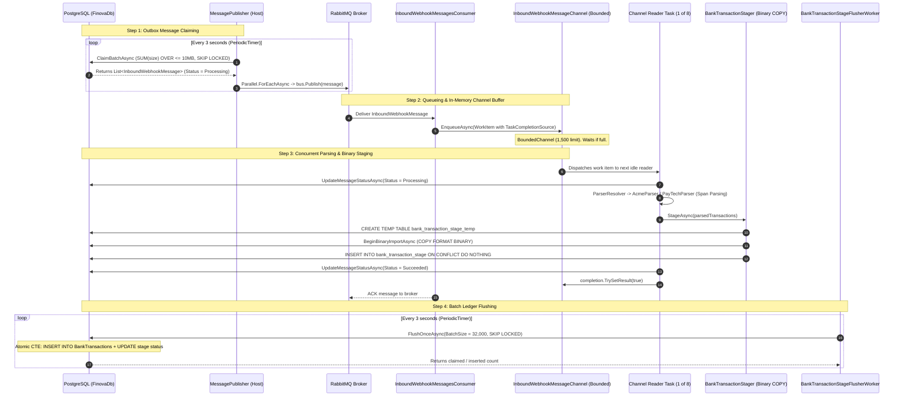

# Background Processing Architecture

## 1. Overview and Rationale

In high-volume banking systems, background processing is not merely a mechanism for running deferred tasks; it is the core engine that shields web clients from I/O bottlenecks and enforces system reliability.

The Finova background processing host ([Finova.Workers/OutboxWorker](/Wallet/Host/Finova.Workers/OutboxWorker)) runs as a separate standalone .NET 10 host process. It is composed of three coordinated subsystems:

1. **The Outbox Publisher ([MessagePublisher](/Wallet/Host/Finova.Workers/OutboxWorker/Workers/MessagePublisher.cs))**: Periodically claims pending messages from PostgreSQL and publishes them to RabbitMQ.
2. **The Inbound Message Channel Pipeline ([InboundWebhookMessageChannel](/Wallet/Host/Finova.Workers/OutboxWorker/Workers/InboundWebhookMessageChannel.cs))**: A bounded in-memory producer-consumer channel fed by MassTransit and consumed by 8 parallel readers.
3. **The Stage Flusher ([BankTransactionStageFlusherWorker](/Wallet/Host/Finova.Workers/OutboxWorker/Workers/BankTransactionStageFlusherWorker.cs))**: A high-speed drain worker that batch-inserts staged transactions into the final permanent ledger.

---

## 2. Component Collaboration Sequence



---

## 3. Worker Implementations and Responsibilities

### 3.1 MessagePublisher
- **File**: [MessagePublisher.cs](/Wallet/Host/Finova.Workers/OutboxWorker/Workers/MessagePublisher.cs)
- **Lifecycle**: Hosted service inheriting from `BackgroundService`.
- **Execution Loop**: Runs on a `PeriodicTimer(TimeSpan.FromSeconds(3))`.
- **Claim Logic**: Calls `outboxWriter.ClaimBatchAsync()`. If no rows are available, enters an idle delay (`_opt.IdleDelay = 1 second`).
- **Bounded Concurrency**:
  ```csharp
  await Parallel.ForEachAsync(
      claimedBag,
      new ParallelOptions
      {
          MaxDegreeOfParallelism = _opt.MaxConcurrency, // Default: 6
          CancellationToken = stoppingToken
      },
      async (message, ct) =>
      {
          await bus.Publish(message, ct);
          logger.LogInformation($"A message with Id: {message.Id} - has published");
      }
  );
  ```
  *Why Bounded Concurrency?* Prevents exhausting the PostgreSQL connection pool or overwhelming RabbitMQ publishing buffers.

---

### 3.2 InboundWebhookMessagesConsumer
- **File**: [InboundWebhookMessagesConsumer.cs](/Wallet/Host/Finova.Workers/OutboxWorker/Workers/InboundWebhookMessagesConsumer.cs)
- **Framework**: MassTransit `IConsumer<InboundWebhookMessage>`.
- **Concurrency Limit**: Configured in [Program.cs](/Wallet/Host/Finova.Workers/OutboxWorker/Program.cs#L38) with `ConcurrentMessageLimit = 8`.
- **Handoff**: Directly enqueues the message into `InboundWebhookMessageChannel` and awaits the returned `TaskCompletionSource`. This ensures MassTransit does **not acknowledge (ACK)** the message to RabbitMQ until the channel readers have completely validated and staged the transactions.

---

### 3.3 InboundWebhookMessageChannel
- **File**: [InboundWebhookMessageChannel.cs](/Wallet/Host/Finova.Workers/OutboxWorker/Workers/InboundWebhookMessageChannel.cs)
- **Architecture**: In-memory producer-consumer queue using `System.Threading.Channels.Channel`.
- **Channel Specifications**:
  - Capacity: **1,500 work items** (`BoundedChannelFullMode.Wait`).
  - `SingleReader = false`, `SingleWriter = false`.
  - `AllowSynchronousContinuations = false`.
- **Worker Pool**: Spawns **8 dedicated reader tasks** at startup:
  ```csharp
  _readerTasks = [
      ReadMessagesAsync(), ReadMessagesAsync(), ReadMessagesAsync(), ReadMessagesAsync(),
      ReadMessagesAsync(), ReadMessagesAsync(), ReadMessagesAsync(), ReadMessagesAsync()
  ];
  ```
- **Graceful Shutdown**: Upon `StopAsync()`, completes the channel writer and awaits `Task.WhenAll(_readerTasks)` so in-flight work items are cleanly drained before process termination.

---

### 3.4 BankTransactionStageFlusherWorker
- **File**: [BankTransactionStageFlusherWorker.cs](/Wallet/Host/Finova.Workers/OutboxWorker/Workers/BankTransactionStageFlusherWorker.cs)
- **Batch Size**: **32,000 transactions per batch**.
- **Drain Loop**:
  ```csharp
  while (await flusherWorker.FlushOnceAsync(BatchSize, stoppingToken) == BatchSize)
  {
      // Keep going immediately while full batches are available!
  }
  ```
  If 100,000 transactions were staged, the flusher drains 32,000 in batch 1, 32,000 in batch 2, 32,000 in batch 3, and the remainder in batch 4 without waiting for the timer tick.

---

## 4. Dependency Injection Scopes and Transaction Boundaries

### 4.1 Scope Management
Background workers are registered as long-running Singletons. However, database contexts (`BanksDbContext`, `TransactionsDbContext`) are Scoped. To avoid memory leaks, context bloat, and multithreaded connection conflicts:

1. **Explicit Scope Creation**: Every execution loop iteration and channel reader creates an isolated scope:
   ```csharp
   using var scope = scopeFactory.CreateScope();
   var bankRepository = scope.ServiceProvider.GetRequiredService<IBankRepository>();
   var transactionServices = scope.ServiceProvider.GetRequiredService<ITransactionServies>();
   ```
2. **Short-Lived Transactions**: Scopes are disposed immediately after the message or batch completes, promptly releasing connections back to the `NpgsqlDataSource` connection pool.

### 4.2 Transaction Boundaries

| Stage | Mechanism | Isolation / Locking | Rollback Behavior |
| :--- | :--- | :--- | :--- |
| **Claiming Batch** | Single atomic SQL `UPDATE ... RETURNING` | `FOR UPDATE SKIP LOCKED` | Locked rows transition to `Processing` (`1`). If crash occurs, recovered by stale cleaner. |
| **Binary Staging** | Explicit `NpgsqlTransaction` | Dedicated DB connection | Temp table dropped `ON COMMIT DROP`. In case of error, `RollbackAsync()` is executed. |
| **Flushing Stage** | Atomic Common Table Expression (CTE) | `FOR UPDATE SKIP LOCKED` | Batch select, insertion into ledger, and stage status update execute in a single atomic SQL statement. |

---

## 5. Failure Handling and Recovery

1. **Stale Processing Recovery**: If a worker node crashes mid-processing, claimed outbox messages remain locked. [BankOutboxWriter.RequeueStaleProcessingMessagesAsync](Wallet/Modules/Banks.Module/Infrastructure/Outbox/BankOutboxWriter.cs#L63) finds messages with `Status = Processing` and `LockedAtUtc < now() - 5 minutes` and resets them to `Pending`.
2. **RabbitMQ Retry Policies**: MassTransit handles transient consumer failures according to retry policies. Unrecoverable messages fail and the worker records an audit record in `MessageProcessingRecords` with status `Failed`.
3. **Invalid Transaction Isolation**: If a single transaction within a 1,000-transaction webhook is invalid (e.g., negative amount, bad date), the valid 999 transactions are still parsed and staged. The rejected transaction is written to `TransacitonProcessingRecords` with the exact validation error message.

---

## 6. Related Documentation

- [Outbox Processing Workflow](/docs/workflows/outbox-processing.md)
- [Transaction Processing Workflow](/docs/workflows/transaction-processing.md)
- [RabbitMQ Infrastructure Guide](/docs/infrastructure/rabbitmq.md)
- [ADR-0002: Outbox Pattern](/docs/decisions/0002-outbox-pattern.md)
- [ADR-0004: Payload-Size-Aware Batching](/docs/decisions/0004-payload-size-aware-batching.md)
