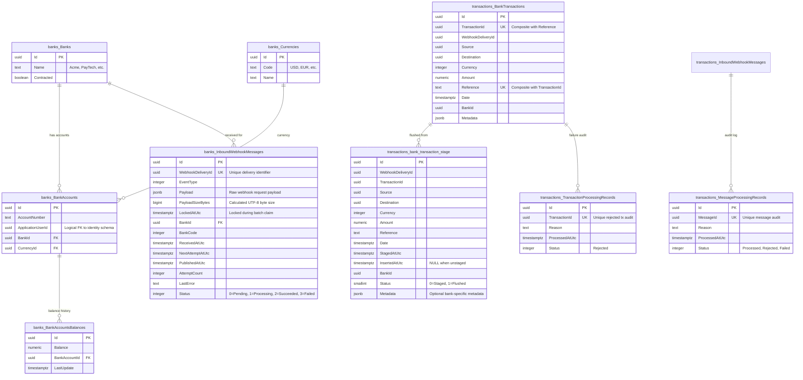

# Database Design and Schema Isolation

## 1. Overview and Core Philosophy

In a high-throughput financial system, database design dictates both processing performance and domain integrity. A common anti-pattern in monolithic applications is treating the database as an unrestricted global data store with foreign keys linking disparate domains.

Finova solves this by maintaining **strict logical schema isolation within a single physical PostgreSQL 17 database (`FinovaDb`)**:

```
PostgreSQL Database: FinovaDb
├── Schema: banks          (Owned exclusively by BanksDbContext)
├── Schema: transactions   (Owned exclusively by TransactionsDbContext)
└── Schema: identity       (Owned exclusively by IdentityModuleDbContext)
```

### 1.1 Physical Co-location vs. Logical Ownership
- **Physical Co-location**: All schemas reside on the same PostgreSQL server instance. This avoids the cost, operational overhead, and distributed commit coordination of managing three separate physical database servers.
- **Logical Ownership**: Each module's EF Core `DbContext` specifies a default schema (`builder.HasDefaultSchema(...)`). No module may read, write, or join across another module's tables directly.
- **No Cross-Schema Foreign Keys**: Foreign keys never cross schema boundaries. References to entities in other schemas (such as `BankId` in the `transactions` schema or `ApplicationUserId` in the `banks` schema) are stored as raw `Guid` values. This ensures that any module could be lifted into an independent physical database in the future with zero relational migration surgery.

---

## 2. Entity Relationship Diagram (ERD)



---

## 3. Schema Definitions and Table Specifications

### 3.1 Schema `banks` (Context: `BanksDbContext`)

Configured in [BanksDbContext.cs](/Wallet/Modules/Banks.Module/Infrastructure/BanksDbContext.cs#L23): `builder.HasDefaultSchema("banks");`

#### Table: `banks."InboundWebhookMessages"` (Outbox Table)
The heart of the asynchronous ingestion pipeline. Stores validated raw webhook payloads.

```sql
CREATE TABLE banks."InboundWebhookMessages" (
    "Id" uuid NOT NULL,
    "WebhookDeliveryId" uuid NOT NULL,
    "EventType" integer NOT NULL,
    "Payload" jsonb NOT NULL,
    "PayloadSizeBytes" bigint NOT NULL,
    "LockedAtUtc" timestamp with time zone NULL,
    "BankId" uuid NOT NULL,
    "BankCode" integer NOT NULL,
    "ReceivedAtUtc" timestamp with time zone NOT NULL,
    "NextAttemptAtUtc" timestamp with time zone NULL,
    "PublishedAtUtc" timestamp with time zone NULL,
    "AttemptCount" integer NOT NULL,
    "LastError" text NULL,
    "Status" integer NOT NULL,
    CONSTRAINT "PK_InboundWebhookMessages" PRIMARY KEY ("Id"),
    CONSTRAINT "FK_InboundWebhookMessages_Banks_BankId" FOREIGN KEY ("BankId") 
        REFERENCES banks."Banks" ("Id") ON DELETE CASCADE
);
```

**Indexes & Performance Tuning**:
- `IX_InboundWebhookMessages_WebhookDeliveryId` (UNIQUE): Enforces database-level deduplication for delivery IDs.
- `IX_InboundWebhookMessages_ReceivedAtUtc_Id` (PARTIAL INDEX):
  ```sql
  CREATE INDEX "IX_InboundWebhookMessages_ReceivedAtUtc_Id" 
  ON banks."InboundWebhookMessages" ("ReceivedAtUtc", "Id") 
  WHERE "Status" = 0;
  ```
  *Rationale*: The Outbox Worker polls only for pending messages (`Status = 0`). A filtered index ensures index scan lookups remain lightning-fast and never bloat with historical processed messages.

#### Tables: `banks."Banks"`, `banks."BankAccounts"`, `banks."BankAccountsBalances"`, `banks."Currencies"`
Standard relational structures managing client bank accounts and ledger balances used by [SendMoneyService.cs](/Wallet/Modules/Banks.Module/Application/Services/SendMoneyService.cs) for outbound transfer validation.

---

### 3.2 Schema `transactions` (Context: `TransactionsDbContext`)

Configured in [TransactionDbContext.cs](/Wallet/Modules/Transactions.Module/Infrastructure/TransactionDbContext.cs#L20): `builder.HasDefaultSchema("transactions");`

#### Table: `transactions."bank_transaction_stage"` (Staging Buffer)
Buffer table populated via high-speed PostgreSQL binary `COPY` during message consumption.

```sql
CREATE TABLE transactions.bank_transaction_stage (
    "Id" uuid NOT NULL,
    "WebhookDeliveryId" uuid NOT NULL,
    "TransactionId" uuid NOT NULL,
    "Source" uuid NOT NULL,
    "Destination" uuid NOT NULL,
    "Currency" integer NOT NULL,
    "Amount" numeric NOT NULL,
    "Reference" text NOT NULL,
    "Date" timestamp with time zone NOT NULL,
    "StagedAtUtc" timestamp with time zone NOT NULL,
    "InsertedAtUtc" timestamp with time zone NULL,
    "BankId" uuid NOT NULL,
    "Status" smallint NOT NULL,
    "Metadata" jsonb NULL,
    CONSTRAINT "PK_bank_transaction_stage" PRIMARY KEY ("Id")
);
```

**Indexes**:
- `IX_bank_transaction_stage_TransactionId_Reference` (UNIQUE): Prevents duplicate staging of the same transaction reference.
- `IX_bank_transaction_stage_StagedAtUtc` (PARTIAL INDEX):
  ```sql
  CREATE INDEX "IX_bank_transaction_stage_StagedAtUtc" 
  ON transactions.bank_transaction_stage ("StagedAtUtc") 
  WHERE "InsertedAtUtc" IS NULL;
  ```
  *Rationale*: Enables [BankTransactionStageFlusher](/Wallet/Modules/Transactions.Module/Infrastructure/BankTransactionStageFlusher.cs) to quickly claim un-inserted batches without scanning already flushed rows.

#### Table: `transactions."BankTransactions"` (Permanent Ledger)
The definitive, immutable transaction store.

```sql
CREATE TABLE transactions."BankTransactions" (
    "Id" uuid NOT NULL,
    "TransactionId" uuid NOT NULL,
    "WebhookDeliveryId" uuid NOT NULL,
    "Source" uuid NOT NULL,
    "Destination" uuid NOT NULL,
    "Currency" integer NOT NULL,
    "Amount" numeric NOT NULL,
    "Reference" text NOT NULL,
    "Date" timestamp with time zone NOT NULL,
    "BankId" uuid NOT NULL,
    "Metadata" jsonb NULL,
    CONSTRAINT "PK_BankTransactions" PRIMARY KEY ("Id")
);
CREATE UNIQUE INDEX "IX_BankTransactions_TransactionId_Reference" 
ON transactions."BankTransactions" ("TransactionId", "Reference");
```

#### Tables: `transactions."MessageProcessingRecords"` & `transactions."TransacitonProcessingRecords"`
Audit tables capturing overall delivery processing status and individual rejected transaction reasons (e.g., malformed date formats, negative amounts, unsupported currencies).

---

### 3.3 Schema `identity` (Context: `IdentityModuleDbContext`)

Configured in [IdentityModuleDbContext.cs](/Wallet/Modules/Identity.Module/Infrastructure/IdentityModuleDbContext.cs#L16): `builder.HasDefaultSchema("identity");`

Houses the standard ASP.NET Core Identity tables (`AspNetUsers`, `AspNetRoles`, `AspNetUserClaims`, etc.) partitioned cleanly under the `identity` schema.

---

## 4. Migrations Management

Because multiple `DbContext` classes target the same database, Entity Framework Core migrations must explicitly specify the target context, startup project, and migrations assembly.

### 4.1 CLI Migration Commands

```bash
# Adding a migration for Banks Module
dotnet ef migrations add <MigrationName> \
    --project Wallet/Modules/Banks.Module/Infrastructure \
    --startup-project Wallet/Host/Finova.API \
    --context BanksDbContext

# Adding a migration for Transactions Module
dotnet ef migrations add <MigrationName> \
    --project Wallet/Modules/Transactions.Module/Infrastructure \
    --startup-project Wallet/Host/Finova.API \
    --context TransactionsDbContext

# Adding a migration for Identity Module
dotnet ef migrations add <MigrationName> \
    --project Wallet/Modules/Identity.Module/Infrastructure \
    --startup-project Wallet/Host/Finova.API \
    --context IdentityModuleDbContext
```

### 4.2 Automated Runtime Migrations
At startup, [Finova.API/Program.cs](/Wallet/Host/Finova.API/Program.cs#L23) invokes:
```csharp
await app.Services.MigrateFinovaDatabasesAsync();
```
which sequentially applies pending migrations across `BanksDbContext`, `IdentityModuleDbContext`, and `TransactionsDbContext` using `Database.MigrateAsync()`.

---

## 5. Related Documentation

- [PostgreSQL Infrastructure Guide](/docs/infrastructure/postgresql.md)
- [Database Migrations Guide](/docs/infrastructure/database-migrations.md)
- [Outbox Processing Workflow](/docs/workflows/outbox-processing.md)
- [Transaction Staging & Bulk Copy ADR](/docs/decisions/0007-transaction-staging-and-bulk-copy.md)
