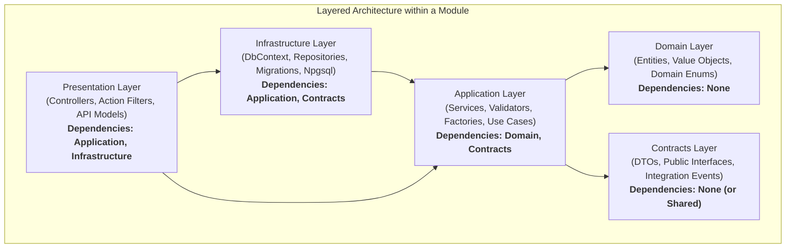
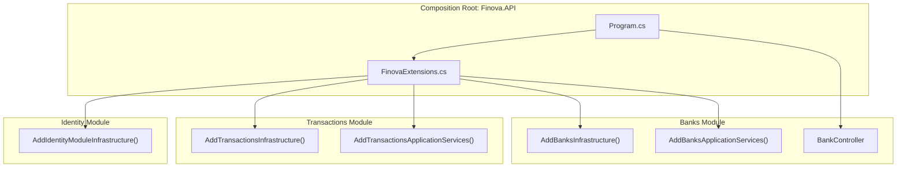

# Dependency Rules and Architectural Governance

## 1. The Need for Strict Governance

In a Modular Monolith, compile-time boundaries are the primary defense against architectural erosion. Without explicit rules, developers can easily add project references that cross domain boundaries, creating circular dependencies, tight coupling, and untestable spaghetti code.

Finova enforces **two orthogonal dimensions of dependency governance**:
1. **Vertical Boundary Rules (Module Isolation)**: Controls which modules may reference each other.
2. **Horizontal Boundary Rules (Layered Architecture)**: Controls how code flows between Domain, Application, Infrastructure, Presentation, and Host layers within and across modules.

---

## 2. Horizontal Layer Dependency Rules

Every module adheres to the dependency inversion principles of Clean Architecture:



### 2.1 The Rules of Layer Flow

1. **Domain has Zero External Dependencies**:
   - `Domain` projects must never reference `Application`, `Infrastructure`, `Presentation`, or external third-party database/HTTP packages.
   - Domain logic represents core business entities (e.g., [Bank.cs](file:///Users/mostafa/IamBack/dotnet-csharp/Finova/Wallet/Modules/Banks.Module/Domain/Entities/Bank.cs), [BankAccount.cs](file:///Users/mostafa/IamBack/dotnet-csharp/Finova/Wallet/Modules/Banks.Module/Domain/Entities/BankAccount.cs)).
2. **Contracts is Lightweight and Stable**:
   - Contains immutable data transfer objects (DTOs), interface contracts, and enums intended for external consumption (e.g., [InboundWebhookMessage.cs](file:///Users/mostafa/IamBack/dotnet-csharp/Finova/Wallet/Modules/Banks.Module/Contracts/Entities/InboundWebhookMessage.cs)).
   - May only reference primitive types or shared common contracts.
3. **Application Depends on Domain and Contracts**:
   - Coordinates business workflows, validation, and transformations (e.g., [TransactionServices.cs](file:///Users/mostafa/IamBack/dotnet-csharp/Finova/Wallet/Modules/Transactions.Module/Application/Services/TransactionServices.cs)).
   - Defines interfaces for persistence without knowing how they are implemented.
4. **Infrastructure Depends on Application**:
   - Implements repositories, sets up EF Core mapping configurations, executes raw Npgsql SQL queries, and manages migrations (e.g., [BankOutboxWriter.cs](file:///Users/mostafa/IamBack/dotnet-csharp/Finova/Wallet/Modules/Banks.Module/Infrastructure/Outbox/BankOutboxWriter.cs)).
5. **Presentation Depends on Application and Infrastructure**:
   - Bridges HTTP web requests to application use cases (e.g., [BankController.cs](file:///Users/mostafa/IamBack/dotnet-csharp/Finova/Wallet/Modules/Banks.Module/Presentation/Controllers/BankController.cs)).

---

## 3. Vertical Cross-Module Dependency Rules

Modules operate as self-contained domain boundaries. The matrix below defines the allowed project references across modules:

| Source Module | Target: Banks | Target: Transactions | Target: Identity | Target: Shared |
| :--- | :---: | :---: | :---: | :---: |
| **Banks.Module** | Internal | **FORBIDDEN** | **FORBIDDEN** | **Allowed** |
| **Transactions.Module** | **Contracts Only** | Internal | **FORBIDDEN** | **Allowed** |
| **Identity.Module** | **FORBIDDEN** | **FORBIDDEN** | Internal | **Allowed** |
| **Finova.API (Host)** | **Allowed** | **Allowed** | **Allowed** | **Allowed** |
| **OutboxWorker (Host)**| **Allowed** | **Allowed** | **FORBIDDEN** | **Allowed** |

### 3.1 Allowed Cross-Module Reference Example
[Transactions.Application.csproj](file:///Users/mostafa/IamBack/dotnet-csharp/Finova/Wallet/Modules/Transactions.Module/Application/Transactions.Application.csproj) contains:

```xml
<ItemGroup>
  <ProjectReference Include="../../Banks.Module/Contracts/Banks.Contracts.csproj" />
  <ProjectReference Include="../Contracts/Transactions.Contracts.csproj" />
  <ProjectReference Include="../Domain/Transactions.Domain.csproj" />
</ItemGroup>
```

`Transactions.Application` requires knowledge of `InboundWebhookMessage` and `ContractedBanks` to parse incoming bank transaction strings. It references **only** `Banks.Contracts.csproj`. It has **no access** to `Banks.Infrastructure` (cannot query `BanksDbContext`), `Banks.Domain`, or `Banks.Presentation`.

### 3.2 Forbidden References
- A module's `Domain`, `Infrastructure`, or `Presentation` layer may **never** reference another module directly.
- `Banks.Module` must never reference `Transactions.Module`.
- `Identity.Module` must never reference `Banks.Module` or `Transactions.Module`.

---

## 4. Host Assemblies as Composition Roots

The two executable hosts ([Finova.API](file:///Users/mostafa/IamBack/dotnet-csharp/Finova/Wallet/Host/Finova.API) and [Finova.Workers/OutboxWorker](file:///Users/mostafa/IamBack/dotnet-csharp/Finova/Wallet/Host/Finova.Workers/OutboxWorker)) act as **Composition Roots**.

- **Dependency Registration**: The host references the Presentation, Application, and Infrastructure projects of each module to register dependencies with the ASP.NET Core / Microsoft Extensions DI container via extension methods (e.g., `AddBanksInfrastructure`, `AddTransactionsInfrastructure`).
- **No Domain Logic in Hosts**: Host projects contain no domain logic, no controllers, and no entity mappings. Their responsibility is strictly configuration, pipeline assembly, and runtime bootstrapping.



---

## 5. Prevention of Circular Dependencies

Circular references between projects cause .NET compiler errors (`MSB4006: There is a circular dependency in the target dependency graph`). Finova prevents circular dependencies structurally:

1. **Unidirectional Contracts Hierarchy**: Contracts projects contain only definitions and have zero project references to other modules.
2. **Asynchronous Messaging for Reverse Communication**: When `Transactions.Module` completes processing of a message, it does not call back into `Banks.Module` directly; instead, it utilizes a callback delegate (`Func<InboundWebhookMessage, InboundTransactionWebhookOutboxMessageStatus, CancellationToken, Task<int>> UpdateMessageStatusDlg`) or publishes domain events.
3. **Automated CI Validation**: The [finova-wallet-ci.yml](file:///Users/mostafa/IamBack/dotnet-csharp/Finova/.github/workflows/finova-wallet-ci.yml) workflow restores and builds the solution on every pull request, immediately detecting any accidental circular or illegal references.

---

## 6. Related Documentation

- [Modular Monolith Architecture](file:///Users/mostafa/IamBack/dotnet-csharp/Finova/docs/architecture/modular-monolith.md)
- [Module Catalog](file:///Users/mostafa/IamBack/dotnet-csharp/Finova/docs/architecture/modules.md)
- [ADR-0001: Modular Monolith Architecture](file:///Users/mostafa/IamBack/dotnet-csharp/Finova/docs/decisions/0001-modular-monolith.md)
