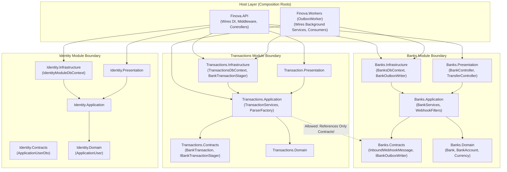

# Modular Monolith Architecture

## 1. Context and Problem Statement

When designing a financial backend application like Finova, engineering teams frequently face an architectural dilemma:

1. **A Traditional Monolith**: All code resides in a single project or layered folders without strict encapsulation. Over time, boundary bleed occurs: controllers directly call arbitrary repositories, database entities from different domains cross-reference each other with foreign keys, and circular dependencies proliferate. The system becomes a "Big Ball of Mud", making refactoring, performance tuning, and reasoning about domain invariants fragile and error-prone.
2. **Microservices Architecture**: The system is partitioned into independently deployed networked services (e.g., Banks Service, Transactions Service, Identity Service, Outbox Service). While this provides independent deployability, it introduces immense operational complexity: network latency, distributed transactions (Sagas/2PC), partial network failures, complex local development environments, distributed tracing overhead, and operational burdens that are disproportionate for this stage of the system.

Finova adopts a **Modular Monolith architecture** to achieve the domain encapsulation and boundary integrity of microservices while retaining the deployment simplicity and transactional clarity of a monolithic deployment.

---

## 2. Architectural Comparison & Trade-Offs

The following matrix summarizes the trade-offs evaluated during the design of Finova:

| Dimension | Traditional Monolith | Microservices | Finova Modular Monolith |
| :--- | :--- | :--- | :--- |
| **Deployment Simplicity** | **High** (Single unit) | **Low** (Mesh of containers, orchestrator required) | **High** (Two hosts: API and Worker) |
| **Domain Encapsulation** | **Low** (Easy to bypass layers and leak abstractions) | **High** (Enforced by network boundaries) | **High** (Enforced by project references and internal access modifiers) |
| **Data Ownership** | **None** (Shared tables, cross-domain FKs) | **Strict** (Database-per-service) | **Strict** (Schema-per-module in single physical DB) |
| **Communication Overhead** | **Zero** (In-memory calls) | **High** (HTTP/gRPC serialization, network hops) | **Negligible** (In-memory contracts / local RabbitMQ broker) |
| **Operational Complexity** | **Low** | **Very High** (Service discovery, distributed tracing, mesh routing) | **Low** (Unified logging, single compose configuration) |
| **Future Extraction Path** | **Difficult** (Deeply tangled coupling) | **N/A** (Already separated) | **Straightforward** (Contracts and schemas already segregated) |

---

## 3. How Modular Monolith is Implemented in Finova

### 3.1 Logical vs. Physical Boundaries

In Finova:
- **Logical Boundaries are Absolute**: Each business domain ([Banks.Module](file:///Users/mostafa/IamBack/dotnet-csharp/Finova/Wallet/Modules/Banks.Module), [Transactions.Module](file:///Users/mostafa/IamBack/dotnet-csharp/Finova/Wallet/Modules/Transactions.Module), [Identity.Module](file:///Users/mostafa/IamBack/dotnet-csharp/Finova/Wallet/Modules/Identity.Module)) is encapsulated in its own directory structure and set of C# projects (`Contracts`, `Domain`, `Application`, `Infrastructure`, `Presentation`).
- **Physical Deployment is Consolidated**: The modules are packaged into two executable host assemblies:
  1. [Finova.API](file:///Users/mostafa/IamBack/dotnet-csharp/Finova/Wallet/Host/Finova.API): The HTTP presentation host.
  2. [Finova.Workers/OutboxWorker](file:///Users/mostafa/IamBack/dotnet-csharp/Finova/Wallet/Host/Finova.Workers/OutboxWorker): The background asynchronous processing host.

> [!IMPORTANT]
> **Not Independently Deployable Services**: The individual modules are **not** deployed as separate containers or serverless functions. They compile into class libraries that are referenced by the runtime hosts. This deliberate trade-off eliminates network hops during internal processing while preserving clean organizational boundaries.

### 3.2 Module Structure Blueprint

Every module in Finova follows the exact same Clean Architecture / DDD folder and project hierarchy, initialized using the [init_Finova.sh](file:///Users/mostafa/IamBack/dotnet-csharp/Finova/init_Finova.sh) scaffolding:

```
Modules/
└── {ModuleName}.Module/
    ├── Contracts/        # Public API: DTOs, interfaces, and events exposed to other modules
    ├── Domain/           # Pure domain entities, value objects, and domain enums (zero external dependencies)
    ├── Application/      # Business services, validation logic, parser factories, and interfaces
    ├── Infrastructure/   # EF Core DbContext, migrations, repositories, and raw SQL queries
    └── Presentation/     # Controllers, action filters, and HTTP presentation models
```

### 3.3 Strict Cross-Module Communication Rules

To prevent coupling and spaghetti dependencies:

1. **Contracts Only**: If Module A needs to interact with Module B, it can **only reference `ModuleB.Contracts`**. It is strictly forbidden to reference `ModuleB.Domain`, `ModuleB.Application`, or `ModuleB.Infrastructure`.
   - *Example*: [Transactions.Application.csproj](file:///Users/mostafa/IamBack/dotnet-csharp/Finova/Wallet/Modules/Transactions.Module/Application/Transactions.Application.csproj#L8) references `Banks.Contracts.csproj`. It has zero access to `Banks.Infrastructure` or `Banks.Domain`.
2. **Asynchronous Messaging**: Long-running or fire-and-forget interactions across modules occur through messages published to RabbitMQ via MassTransit, such as [InboundWebhookMessage](file:///Users/mostafa/IamBack/dotnet-csharp/Finova/Wallet/Modules/Banks.Module/Contracts/Entities/InboundWebhookMessage.cs).
3. **Internal Classes by Default**: Application and infrastructure implementations are marked `internal` (using `InternalsVisibleTo` only for unit test projects), preventing other projects from accidentally constructing or calling them directly.

---

## 4. Module Interaction Diagram



---

## 5. Benefits Realized in Finova

1. **Independent Evolution**: Teams can alter transaction parsing strategies or rewrite staging logic in `Transactions.Module` without touching or risking regressions in `Banks.Module` webhook authorization.
2. **Simplified Developer Workflow**: Developers run the entire platform with one `docker compose up -d` command and two `dotnet run` commands. There is no need for local Kubernetes clusters, service meshes, or distributed debugging proxies.
3. **Isolated Testability**: Each module maintains isolated unit test projects ([Banks.Module.UnitTests](file:///Users/mostafa/IamBack/dotnet-csharp/Finova/Wallet/Tests/UnitTesting/Banks.Module.UnitTests), [Transactions.Module.UnitTests](file:///Users/mostafa/IamBack/dotnet-csharp/Finova/Wallet/Tests/UnitTesting/Transactions.Module.UnitTests), [OutboxWorker.UnitTests](file:///Users/mostafa/IamBack/dotnet-csharp/Finova/Wallet/Tests/UnitTesting/OutboxWorker.UnitTests)) that mock contracts rather than requiring live databases or network listeners.
4. **Clean Migration Path**: If transaction volume grows to a scale requiring independent horizontal scaling of the transaction processing engine onto dedicated GPU/high-memory worker clusters, `Transactions.Module` is already architecturally isolated and ready for extraction into an independent service.

---

## 6. Related Documentation

- [Module Responsibilities & Catalog](file:///Users/mostafa/IamBack/dotnet-csharp/Finova/docs/architecture/modules.md)
- [Dependency Rules & Boundary Enforcement](file:///Users/mostafa/IamBack/dotnet-csharp/Finova/docs/architecture/dependency-rules.md)
- [Database Design & Schema Isolation](file:///Users/mostafa/IamBack/dotnet-csharp/Finova/docs/architecture/database-design.md)
- [ADR-0001: Modular Monolith Architecture](file:///Users/mostafa/IamBack/dotnet-csharp/Finova/docs/decisions/0001-modular-monolith.md)
