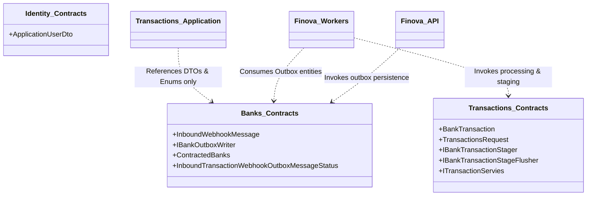

# Module Catalog and Responsibilities

## 1. Overview of Modules

Finova is composed of three core business modules and one shared cross-cutting utility library:

| Module | Core Responsibility | Physical Schema | Key Host Consumers |
| :--- | :--- | :--- | :--- |
| **[Banks.Module](/Wallet/Modules/Banks.Module)** | Bank relationships, webhook authentication, delivery validation, outbox persistence, fund transfer XML generation | `banks` | `Finova.API`, `OutboxWorker` |
| **[Transactions.Module](/Wallet/Modules/Transactions.Module)** | Transaction validation, bank-specific string parsing, high-speed binary staging, batch persistence, duplicate rejection | `transactions` | `Finova.API`, `OutboxWorker` |
| **[Identity.Module](/Wallet/Modules/Identity.Module)** | Wallet user identity, security, authentication tokens, user-to-account relationships | `identity` | `Finova.API` |
| **[Shared](/Wallet/Shared)** | Cross-cutting exception handlers, base repositories, HTTP request routing utilities | Shared Library | All modules |

---

## 2. Banks.Module

### 2.1 Business Responsibility
The `Banks.Module` manages all interactions and contractual relationships with external partner banks (e.g., Acme, PayTech, GothamPayments, BanqueTech). It is responsible for:
- Authenticating incoming public webhook deliveries via bank-specific HMAC-SHA256 signatures and timestamp window verification.
- Validating delivery metadata (ensuring bank contracted status, delivery ID freshness, non-empty payloads).
- Writing raw inbound webhook payloads to the Outbox table for decoupled asynchronous processing.
- Generating outbound inter-bank fund transfer XML messages (`PaymentRequestMessage`) validated against sender account balances.

### 2.2 Layer Breakdown & Main Components

| Layer | Project | Key Classes & Interfaces | Responsibilities |
| :--- | :--- | :--- | :--- |
| **Contracts** | [Banks.Contracts.csproj](/Wallet/Modules/Banks.Module/Contracts/Banks.Contracts.csproj) | [InboundWebhookMessage](/Wallet/Modules/Banks.Module/Contracts/Entities/InboundWebhookMessage.cs) [IBankOutboxWriter](/Wallet/Modules/Banks.Module/Contracts/Interfaces/IBankOutboxWriter.cs) [ContractedBanks](/Wallet/Modules/Banks.Module/Contracts/Enums/ContractedBanks.cs) [InboundTransactionWebhookOutboxMessageStatus](/Wallet/Modules/Banks.Module/Contracts/Enums/WebhookOutboxMessage.cs) | Data contracts, outbox entities, and enums exposed to other modules and background workers. |
| **Domain** | [Banks.Domain.csproj](/Wallet/Modules/Banks.Module/Domain/Banks.Domain.csproj) | [Bank](/Wallet/Modules/Banks.Module/Domain/Entities/Bank.cs) [BankAccount](/Wallet/Modules/Banks.Module/Domain/Entities/BankAccount.cs) [BankAccountBalance](/Wallet/Modules/Banks.Module/Domain/Entities/BankAccountBalance.cs) [Currency](/Wallet/Modules/Banks.Module/Domain/Entities/Currency.cs) | Core domain entities modeling bank contracts, accounts, and balance ledgers. |
| **Application** | [Banks.Application.csproj](/Wallet/Modules/Banks.Module/Application/Banks.Application.csproj) | [BankServices](/Wallet/Modules/Banks.Module/Application/Services/BankServices.cs) [SendMoneyService](/Wallet/Modules/Banks.Module/Application/Services/SendMoneyService.cs) [BankWebhookAuthorizationService](/Wallet/Modules/Banks.Module/Application/Services/WebhookFilter/BankWebhookAuthorizationService.cs) [WebhookRequestAuthenticator](/Wallet/Modules/Banks.Module/Application/Services/WebhookFilter/WebhookRequestAuthenticator.cs) [WebhookDeliveryValidator](/Wallet/Modules/Banks.Module/Application/Services/WebhookFilter/WebhookDeliveryValidator.cs) | Business logic for webhook authorization, payload size calculation, and transfer XML creation. |
| **Infrastructure** | [Banks.Infrastructure.csproj](/Wallet/Modules/Banks.Module/Infrastructure/Banks.Infrastructure.csproj) | [BanksDbContext](/Wallet/Modules/Banks.Module/Infrastructure/BanksDbContext.cs) [BankOutboxWriter](/Wallet/Modules/Banks.Module/Infrastructure/Outbox/BankOutboxWriter.cs) [BankRepository](/Wallet/Modules/Banks.Module/Infrastructure/Repositories/BankRepository.cs) [BankAccountTransferRepository](/Wallet/Modules/Banks.Module/Infrastructure/Repositories/BankAccountTransferRepository.cs) | Persistence in the `banks` schema, payload-size-aware SQL queries, and EF migrations. |
| **Presentation** | [Banks.Presentation.csproj](/Wallet/Modules/Banks.Module/Presentation/Banks.Presentation.csproj) | [BankController](/Wallet/Modules/Banks.Module/Presentation/Controllers/BankController.cs) [TransferController](/Wallet/Modules/Banks.Module/Presentation/Controllers/TransferController.cs) [AuthorizeBankTransactionWebhookAttribute](/Wallet/Modules/Banks.Module/Presentation/Filters/AuthorizeBankTransactionWebhookAttribute.cs) [IdempotencyAttribute](/Wallet/Modules/Banks.Module/Presentation/Filters/IdempotencyAttribute.cs) | Exposes HTTP routes, action filters, and request timeout configurations. |

### 2.3 Exposed Interfaces & Contracts
- `IBankOutboxWriter`: Used by `BankServices` to persist outbox messages and by `MessagePublisher` to claim batches via `ClaimBatchAsync`.
- `IBankRepository`: Encapsulates bank contract status and status updates for inbound messages.
- `InboundWebhookMessage`: The integration entity published to RabbitMQ.

### 2.4 Dependencies
- References `Shared.csproj` for common infrastructure.
- Zero compile-time references to `Transactions.Module` or `Identity.Module`.

---

## 3. Transactions.Module

### 3.1 Business Responsibility
The `Transactions.Module` handles transaction-level semantics, parsing, deduplication, and high-performance ingestion. It is responsible for:
- Validating transaction arrays (requiring non-empty IDs, distinct source/destination accounts, supported currencies).
- Resolving bank-specific parser implementations using a dynamic Factory Pattern.
- Executing high-speed, zero-allocation string parsing using `ReadOnlySpan<char>`.
- Recording rejected or malformed transactions with detailed error reasons in audit tables.
- Staging valid transactions via high-speed PostgreSQL binary `COPY` into `bank_transaction_stage`.
- Batch flushing staged rows into the permanent `BankTransactions` ledger.

### 3.2 Layer Breakdown & Main Components

| Layer | Project | Key Classes & Interfaces | Responsibilities |
| :--- | :--- | :--- | :--- |
| **Contracts** | [Transactions.Contracts.csproj](/Wallet/Modules/Transactions.Module/Contracts/Transactions.Contracts.csproj) | [BankTransaction](/Wallet/Modules/Transactions.Module/Contracts/Entities/BankTransaction.cs) [BankTransactionStaging](/Wallet/Modules/Transactions.Module/Contracts/Entities/BankTransactionStaging.cs) [TransactionsRequest](/Wallet/Modules/Transactions.Module/Contracts/Entities/TransactionsRequest.cs) [IBankTransactionStager](/Wallet/Modules/Transactions.Module/Contracts/Interfaces/IBankTransactionStager.cs) [IBankTransactionStageFlusher](/Wallet/Modules/Transactions.Module/Contracts/Interfaces/IBankTransactionStageFlusher.cs) [ITransactionStringParser](/Wallet/Modules/Transactions.Module/Contracts/Interfaces/ITransactionStringParser.cs) | Transaction contracts, staging abstractions, parser interfaces, and status enums. |
| **Domain** | [Transactions.Domain.csproj](/Wallet/Modules/Transactions.Module/Domain/Transactions.Domain.csproj) | Enums and core domain invariants for transactions. | Pure domain modeling with no external references. |
| **Application** | [Transactions.Application.csproj](/Wallet/Modules/Transactions.Module/Application/Transactions.Application.csproj) | [TransactionServices](/Wallet/Modules/Transactions.Module/Application/Services/TransactionServices.cs) [TransactionServicesValidator](/Wallet/Modules/Transactions.Module/Application/Services/TransactionRequestValidator.cs) [BankTransactionParserResolver](/Wallet/Modules/Transactions.Module/Application/Services/BankTransactionParserFactory/BankTransactionParserResolver.cs) [AcmeParser](/Wallet/Modules/Transactions.Module/Application/Services/BankTransactionParserFactory/AcmeParser.cs) [PayTechParser](/Wallet/Modules/Transactions.Module/Application/Services/BankTransactionParserFactory/PayTechParser.cs) | Parallel transaction processing, validation, bank factory resolution, and span parsing. |
| **Infrastructure** | [Transactions.Infrastructure.csproj](/Wallet/Modules/Transactions.Module/Infrastructure/Transactions.Infrastructure.csproj) | [TransactionsDbContext](/Wallet/Modules/Transactions.Module/Infrastructure/TransactionDbContext.cs) [BankTransactionStager](/Wallet/Modules/Transactions.Module/Infrastructure/BankTransactionStager.cs) [BankTransactionStageFlusher](/Wallet/Modules/Transactions.Module/Infrastructure/BankTransactionStageFlusher.cs) [TransactionRepository](/Wallet/Modules/Transactions.Module/Infrastructure/Repositories/TransactionRepository.cs) | `transactions` schema ownership, binary `COPY` import, stage flushing SQL, and duplicate handling. |
| **Presentation** | [Transaction.Presentation.csproj](/Wallet/Modules/Transactions.Module/Presentation/Transaction.Presentation.csproj) | Presentation assembly placeholder for future customer-facing transaction query endpoints. | HTTP presentation boundary. |

### 3.3 Exposed Interfaces & Contracts
- `ITransactionServies`: Consumed by background workers to process an inbound webhook message payload.
- `IBankTransactionStager`: High-speed binary importer.
- `IBankTransactionStageFlusher`: Batch flusher that drains staging into the permanent ledger.
- `IBankTransactionFactory` / `ITransactionStringParser`: Parser extension points.

### 3.4 Dependencies
- References `Banks.Contracts.csproj` to receive `InboundWebhookMessage` data and bank code definitions.
- References `Shared.csproj`.
- Zero references to `Banks.Infrastructure`, `Banks.Application`, or `Identity.Module`.

---

## 4. Identity.Module

### 4.1 Business Responsibility
The `Identity.Module` encapsulates user authentication, user account records, and authorization tokens. It is responsible for:
- Managing wallet user identities using ASP.NET Core Identity.
- Providing user credentials and token validation for client operations (e.g., authenticating `TransferController`).
- Maintaining the `identity` PostgreSQL schema.

### 4.2 Layer Breakdown & Main Components
- **Contracts** ([Identity.Contracts.csproj](/Wallet/Modules/Identity.Module/Contracts/Identity.Contracts.csproj)): Exposes `ApplicationUserDto` for inter-module user lookups.
- **Domain** ([Identity.Domain.csproj](/Wallet/Modules/Identity.Module/Domain/Identity.Domain.csproj)): Contains [ApplicationUser](/Wallet/Modules/Identity.Module/Domain/ApplicationUser.cs) inheriting from `IdentityUser<Guid>`.
- **Infrastructure** ([Identity.Infrastructure.csproj](/Wallet/Modules/Identity.Module/Infrastructure/Identity.Infrastructure.csproj)): Contains [IdentityModuleDbContext](/Wallet/Modules/Identity.Module/Infrastructure/IdentityModuleDbContext.cs) configured for the `identity` schema and [IdentityInfrastructureExtension.cs](/Wallet/Modules/Identity.Module/Infrastructure/IdentityInfrastructureExtension.cs).

### 4.3 Dependencies
- References `Shared.csproj`.
- Zero references to `Banks.Module` or `Transactions.Module`.

---

## 5. Shared Project

### 5.1 Responsibility
The [Shared](/Wallet/Shared) library provides common infrastructure abstractions and cross-cutting utilities utilized across all modules:
- **Base Persistence**: [BaseRepository.cs](/Wallet/Shared/Infrastructure/Repositories/BaseRepository.cs) providing standard CRUD primitives over EF Core DbContexts.
- **Request Utilities**: [RequestUtilities.cs](/Wallet/Shared/Services/RequestUtilities.cs) for safely extracting route parameters across Action and Authorization filter contexts.
- **Global Error Handling**: [InternalConfigurationExceptionHandler.cs](/Wallet/Shared/Exceptions/InternalConfigurationExceptionHandler.cs) and [InternalConfigurationException.cs](/Wallet/Shared/Exceptions/InternalConfigurationException.cs) providing RFC 7807 ProblemDetails responses without leaking internal configuration secrets.

---

## 6. Summary of Inter-Module Boundaries

