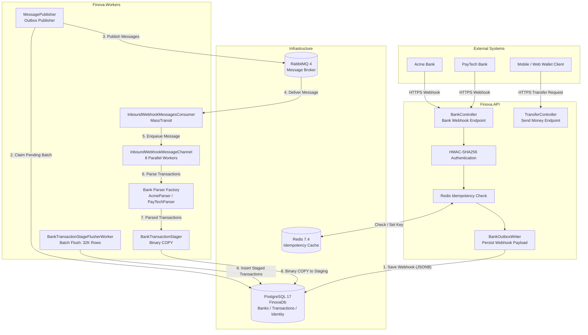
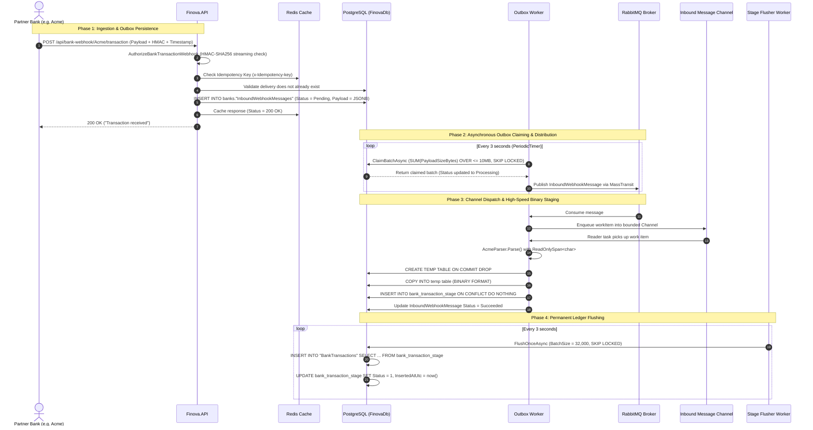

# Architecture Overview

## 1. Executive Summary

**Finova** is a high-throughput, enterprise-grade digital wallet platform built with .NET 10. The core business purpose of Finova is to process banking notifications when clients receive funds or execute outbound payments, ensuring absolute data integrity, zero duplicate transaction execution, and sustained ingestion throughput of thousands of transactions per second.

Rather than implementing a distributed mesh of microservices or an unconstrained monolithic application, Finova is architected as a **Modular Monolith**. It pairs clean DDD-inspired module boundaries with an asynchronous **Outbox Pattern**, an in-memory **producer-consumer channel pipeline**, and **high-performance PostgreSQL binary COPY batch persistence**.

---

## 2. Design Principles & Architectural Goals

The platform's architectural choices are guided by five fundamental engineering goals:

1. **Non-Blocking Ingestion**: A banking partner must never be kept waiting while thousands of transaction rows are parsed, validated, and persisted. HTTP response latency must remain under 50ms regardless of batch size.
2. **Predictable Memory Footprint**: Incoming batches vary from a single transaction to 1,000 transactions. Fixed-row background processing causes severe memory spikes. Memory consumption must be bound by **payload size limits** rather than arbitrary row counts.
3. **Multi-Tier Idempotency**: In distributed financial systems, network retries and duplicate webhook posts are inevitable. The platform must reject duplicates at the edge (caching layer) and enforce hard uniqueness constraints at the persistence layer.
4. **Zero-Allocation Data Ingestion**: High-throughput transaction parsing should minimize garbage collection pressure by utilizing memory slices (`ReadOnlySpan<char>`) rather than allocating millions of intermediate string objects.
5. **Clear Logical Boundaries with Operational Simplicity**: Business capabilities are segregated into isolated modules with private domain models and distinct database schemas, avoiding premature microservice operational overhead while remaining easy to split into separate services if organizational scale warrants it.

---

## 3. High-Level Component Landscape

The physical deployment and runtime topology consists of two .NET hosts and three supporting infrastructure systems:

---

## 4. System Components & Responsibilities

### 4.1 Finova.API Host
The [Finova.API](Wallet/Host/Finova.API) host is the public-facing HTTP ingress point.
- **Entry Point**: [Program.cs](Wallet/Host/Finova.API/Program.cs)
- **Role**:
  - Exposes RESTful endpoints for bank webhook notifications (`/api/bank-webhook/{bankCode}/transaction`) and client fund transfers (`/api/transfers/send`).
  - Executes early request validation and cryptographic verification via Action and Authorization Filters before deserializing large payloads.
  - Implements global partitioned rate limiting (30,000 requests/minute per host/user).
  - Performs non-blocking persistence of webhook payloads directly into the Outbox table.
  - Manages database schema migrations upon startup across all module database contexts.

### 4.2 Finova.Workers (OutboxWorker) Host
The [Finova.Workers/OutboxWorker](Wallet/Host/Finova.Workers/OutboxWorker) host is a dedicated background processing process.
- **Entry Point**: [Program.cs](Wallet/Host/Finova.Workers/OutboxWorker/Program.cs)
- **Role**:
  - **Message Claiming & Publishing** ([MessagePublisher.cs](Wallet/Host/Finova.Workers/OutboxWorker/Workers/MessagePublisher.cs)): Periodically retrieves pending outbox messages from PostgreSQL using payload-size-aware SQL queries with `FOR UPDATE SKIP LOCKED`, then publishes them to RabbitMQ.
  - **Message Consumption** ([InboundWebhookMessagesConsumer.cs](Wallet/Host/Finova.Workers/OutboxWorker/Workers/InboundWebhookMessagesConsumer.cs)): Consumes messages via MassTransit with bounded concurrency.
  - **Pipeline Processing** ([InboundWebhookMessageChannel.cs](Wallet/Host/Finova.Workers/OutboxWorker/Workers/InboundWebhookMessageChannel.cs)): Buffers inbound messages in a bounded channel (capacity 1,500) and dispatches them across 8 parallel reader worker tasks.
  - **Parsing & Binary Staging** ([BankTransactionStager.cs](Wallet/Modules/Transactions.Module/Infrastructure/BankTransactionStager.cs)): Parses transaction strings using zero-allocation span parsers and writes them to a temporary table using PostgreSQL binary `COPY`, then inserts into the staging table.
  - **Batch Stage Flushing** ([BankTransactionStageFlusherWorker.cs](Wallet/Host/Finova.Workers/OutboxWorker/Workers/BankTransactionStageFlusherWorker.cs)): Periodically flushes staged transactions to the final `BankTransactions` table in batches of 32,000 rows.

### 4.3 PostgreSQL 17 Storage
A single PostgreSQL instance (`FinovaDb`) is partitioned into three strictly isolated logical schemas:
- `banks`: Stores contracted bank profiles, bank accounts, balances, and the outbox messages table (`InboundWebhookMessages`).
- `transactions`: Stores transaction staging (`bank_transaction_stage`), permanent transaction records (`BankTransactions`), and audit logs (`MessageProcessingRecords`, `TransacitonProcessingRecords`).
- `identity`: Stores ASP.NET Core Identity users and roles.

### 4.4 Redis 7.4 Distributed Cache
- Acts as a distributed fast-path idempotency cache.
- Prevents concurrent duplicate webhook executions by tracking in-flight keys (`Status = 102 Processing`) and returning `409 Conflict`.
- Caches completed responses for 3 minutes to return identical idempotent responses.

### 4.5 RabbitMQ 4 Message Broker
- Integrated via MassTransit with kebab-case exchange and queue naming.
- Provides reliable message queueing between outbox publishing and transaction processing, decoupling database transactions from worker thread availability.

---

## 5. End-to-End Processing Flow

The lifecycle of an incoming bank transaction webhook proceeds through four distinct phases:

---

## 6. Structural Cross-References

| Area | Primary Document | Source Location |
| :--- | :--- | :--- |
| **Modular Monolith** | [modular-monolith.md](docs/architecture/modular-monolith.md) | [Wallet/Modules](Wallet/Modules) |
| **Module Details** | [modules.md](docs/architecture/modules.md) | [Banks](Wallet/Modules/Banks.Module), [Transactions](Wallet/Modules/Transactions.Module), [Identity](Wallet/Modules/Identity.Module) |
| **Dependency Governance** | [dependency-rules.md](docs/architecture/dependency-rules.md) | [init_Finova.sh](init_Finova.sh) |
| **Database Architecture** | [database-design.md](docs/architecture/database-design.md) | [BanksDbContext.cs](Wallet/Modules/Banks.Module/Infrastructure/BanksDbContext.cs), [TransactionDbContext.cs](Wallet/Modules/Transactions.Module/Infrastructure/TransactionDbContext.cs) |
| **Background Processing** | [background-processing.md](docs/architecture/background-processing.md) | [Wallet/Host/Finova.Workers/OutboxWorker](Wallet/Host/Finova.Workers/OutboxWorker) |
