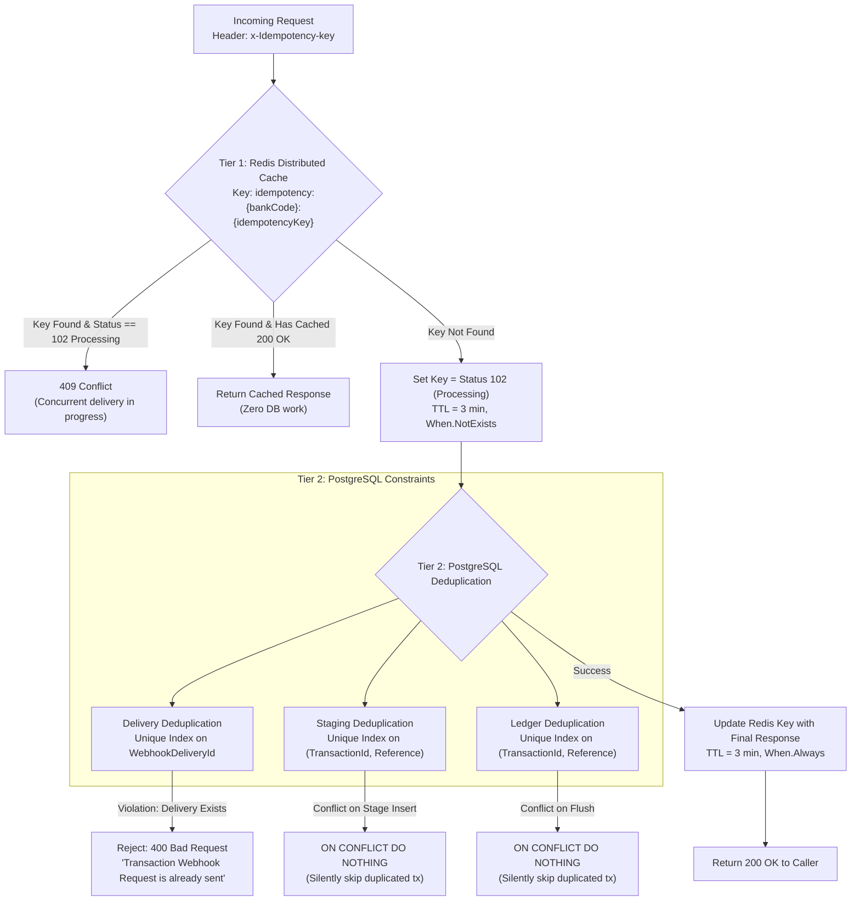

# Idempotency Architecture & Deduplication Strategy

## 1. Why Idempotency is Critical in Financial Systems

In distributed financial computing, the network is inherently unreliable. Bank webhooks, client payment submissions, and message queue consumers operate under **at-least-once delivery semantics**:

- An external bank might send a webhook, experience a TCP connection timeout before receiving our HTTP 200 response, and automatically retransmit the identical payload.
- A client clicking "Send Money" might double-click or reload their browser during network congestion.
- A message broker might redeliver an unacknowledged outbox message if a worker takes longer than usual to stage rows.

Without rigorous idempotency, duplicate deliveries result in **double credits, phantom balances, or duplicated fund transfers**.

Finova implements a **Two-Tier Idempotency Model**:
1. **Tier 1 (Fast-Path Edge Layer)**: Distributed in-memory tracking via Redis to short-circuit duplicates and detect concurrent in-flight requests.
2. **Tier 2 (Hard Persistence Layer)**: Database-level unique indexes and `ON CONFLICT DO NOTHING` guarantees in PostgreSQL to prevent duplicate records even if the cache fails.

---

## 2. The Two-Tier Architecture



---

## 3. Tier 1: Redis Distributed Cache Idempotency

Implemented via [IdempotencyAttribute.cs](/Wallet/Modules/Banks.Module/Presentation/Filters/IdempotencyAttribute.cs) as an ASP.NET Core Action Filter applied to webhook endpoints:

### 3.1 Idempotency Key Structure
The cache key is namespaced by bank code to guarantee multi-tenant tenant isolation:
`idempotency:{bankCode}:{idempotencyKey}`

### 3.2 Handling In-Progress Requests (Race Conditions)
If two identical webhook deliveries hit two load-balanced API nodes at the exact same millisecond:
1. Node A executes:
   ```csharp
   await _database.StringSetAsync(
       redisKey,
       progressJson, // Status: 102 Processing, Value: "in-progress"
       TimeSpan.FromMinutes(3),
       when: When.NotExists
   );
   ```
2. Because Redis is single-threaded, Node A's write succeeds (`When.NotExists == true`). Node A proceeds to the controller.
3. Node B executes the same write, but the key now exists. Node B reads the existing key, inspects `StatusCode == StatusCodes.Status102Processing`, and halts:
   ```csharp
   if (cacheResponse?.StatusCode == StatusCodes.Status102Processing)
   {
       context.Result = new StatusCodeResult(StatusCodes.Status409Conflict);
       return;
   }
   ```
4. Node B immediately returns **HTTP 409 Conflict**, preventing concurrent execution threads from racing against the database.

### 3.3 Returning Cached Responses
When Node A successfully completes:
```csharp
if (executed.Result is ObjectResult objectResult && objectResult.StatusCode >= 200 && objectResult.StatusCode < 300)
{
    var responseCache = new CacheResponse
    {
        StatusCode = (int)objectResult.StatusCode,
        Value = objectResult.Value
    };
    await _database.StringSetAsync(redisKey, JsonSerializer.Serialize(responseCache), TimeSpan.FromMinutes(3), When.Always);
}
```
If the partner bank retries the request 30 seconds later, the filter finds the cached object and returns the exact same `200 OK` response payload without executing any database queries.

---

## 4. Tier 2: Database-Level Protection (PostgreSQL)

Redis provides high-speed, non-blocking protection. However, distributed caches can experience key evictions, network partitions, or node restarts. PostgreSQL enforces immutable guarantees:

### 4.1 Delivery-Level Deduplication
In `banks."InboundWebhookMessages"`:
```csharp
builder.HasIndex(msg => msg.WebhookDeliveryId).IsUnique();
```
- [WebhookDeliveryValidator](/Wallet/Modules/Banks.Module/Application/Services/WebhookFilter/WebhookDeliveryValidator.cs#L28) checks `outboxWriter.ExistsByDeliveryIdAsync()`.
- If an outbox row with the same `WebhookDeliveryId` already exists in PostgreSQL, the request is rejected with `ValidationException("Transaction Webhook Request is already sent to us.")`.
- If two concurrent requests slip past Redis, PostgreSQL's unique constraint triggers a database unique violation, guaranteeing that duplicate messages are never inserted into the outbox.

### 4.2 Staging-Level Deduplication
In `transactions.bank_transaction_stage`:
```csharp
builder.HasIndex(x => new { x.TransactionId, x.Reference }).IsUnique();
```
When [BankTransactionStager.cs](/Wallet/Modules/Transactions.Module/Infrastructure/BankTransactionStager.cs#L37) copies items from the temporary table:
```sql
INSERT INTO transactions.bank_transaction_stage (...)
SELECT ... FROM bank_transaction_stage_temp
ON CONFLICT ("TransactionId", "Reference") DO NOTHING;
```
If a bank webhook reports transactions that were already staged in an earlier batch, `ON CONFLICT DO NOTHING` silently skips the duplicate rows.

### 4.3 Ledger-Level Deduplication
In `transactions."BankTransactions"`:
```csharp
builder.HasIndex(x => new { x.TransactionId, x.Reference }).IsUnique();
```
When [BankTransactionStageFlusher.cs](/Wallet/Modules/Transactions.Module/Infrastructure/BankTransactionStageFlusher.cs#L30) drains batches:
```sql
INSERT INTO transactions."BankTransactions" (...)
SELECT ... FROM transactions.bank_transaction_stage s
JOIN batch b ON b."Id" = s."Id"
ON CONFLICT ("TransactionId", "Reference") DO NOTHING
RETURNING 1;
```
Even if staging contained repeated references, the final ledger entry will never contain duplicates.

---

## 5. Scenario Matrix & System Behavior

| Scenario | Tier 1 (Redis) Action | Tier 2 (PostgreSQL) Action | Resulting Response |
| :--- | :--- | :--- | :--- |
| **Normal First Request** | Key set to `102`, then updated to `200` | Insert outbox row successfully | `200 OK ("Transaction received")` |
| **Concurrent Request (Same Key)** | Detects `Status == 102` | Never reaches database | `409 Conflict` |
| **Retried Request (< 3 min)** | Detects cached `200 OK` | Never reaches database | `200 OK` (Served from Redis) |
| **Retried Request (> 3 min, Key Expired)** | Cache miss; sets key to `102` | `ExistsByDeliveryIdAsync` finds ID | `400 Bad Request ("Already sent to us")` |
| **Redis Node Outage** | Bypassed or error caught | Unique index enforces uniqueness | Duplicates rejected at DB level |
| **Identical Transaction in Different Webhook** | Allowed (Different delivery ID) | `ON CONFLICT ("TransactionId", "Reference") DO NOTHING` | Staged/Flushed safely without duplicating funds |

---

## 6. Related Documentation

- [Webhook Ingestion Workflow](/docs/workflows/webhook-ingestion.md)
- [Transaction Processing Workflow](/docs/workflows/transaction-processing.md)
- [Redis Infrastructure Guide](/docs/infrastructure/redis.md)
- [ADR-0003: Idempotency Strategy](/docs/decisions/0003-idempotency-strategy.md)
