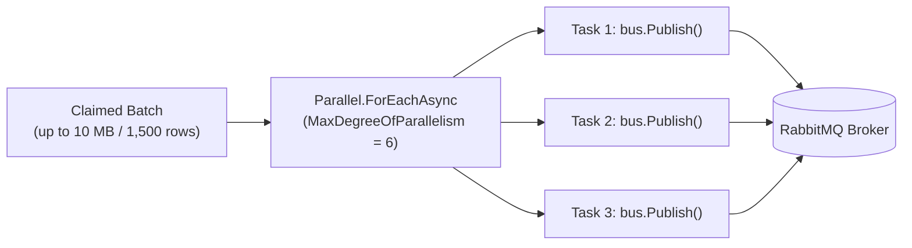
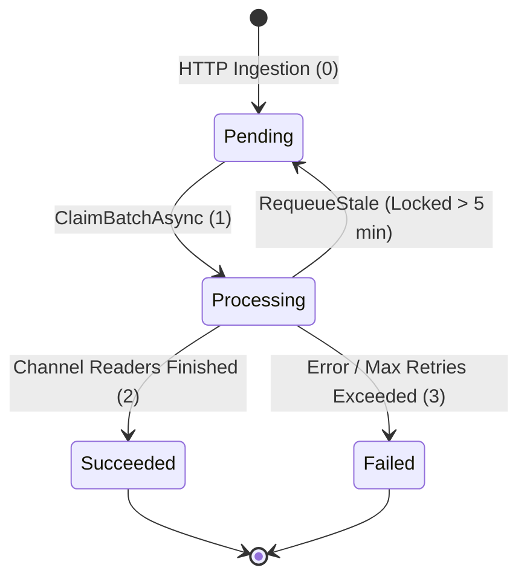

# Outbox Processing & Payload-Size-Aware Batching

## 1. Overview and Problem Definition

The **Transactional Outbox Pattern** is employed by Finova to decouple synchronous HTTP webhook ingestion from the heavier work of transaction validation, parsing, staging, and ledger persistence.

When ingesting banking webhooks, a critical scaling problem arises: **payload size variance**.
- In standard outbox implementations, a background worker queries for a fixed row limit:
  `SELECT * FROM Outbox WHERE Status = 'Pending' LIMIT 100;`
- In a financial webhook system, row counts are uncorrelated with memory consumption:
  - 100 messages containing 1 transaction each = **100 transactions** (~15 KB payload).
  - 100 messages containing 1,000 transactions each = **100,000 transactions** (~150 MB raw JSON, consuming hundreds of megabytes once deserialized into .NET object graphs).

Fixed-row batching either under-utilizes processing capacity or causes severe memory spikes, Garbage Collection pauses, and Out-Of-Memory (OOM) crashes under heavy load.

Finova solves this challenge by implementing **Payload-Size-Aware Batch Selection**.

---

## 2. Ingestion-Time Payload Sizing

Before an outbox row is inserted, [BankServices.cs](file:///Users/mostafa/IamBack/dotnet-csharp/Finova/Wallet/Modules/Banks.Module/Application/Services/BankServices.cs#L26) computes the exact byte count of the raw JSON string:

```csharp
var jsonStr = request.Payload.RootElement.GetRawText();
long payloadSizeBytes = Encoding.UTF8.GetByteCount(jsonStr);
```

This value is persisted into the `PayloadSizeBytes` column of `banks."InboundWebhookMessages"`. The background worker can then filter and aggregate on this precomputed column without needing to inspect or deserialize the JSON payload itself.

---

## 3. Payload-Size-Aware SQL Query

In [BankOutboxWriter.cs](file:///Users/mostafa/IamBack/dotnet-csharp/Finova/Wallet/Modules/Banks.Module/Infrastructure/Outbox/BankOutboxWriter.cs#L14), `ClaimBatchAsync` executes an atomic PostgreSQL Common Table Expression (CTE) utilizing window functions and `FOR UPDATE SKIP LOCKED`:

```sql
WITH picked AS (
    SELECT id FROM (
        SELECT "Id" AS id,
               "PayloadSizeBytes" AS size,
               SUM("PayloadSizeBytes") OVER (
                   ORDER BY "ReceivedAtUtc", "Id"
               ) AS running
        FROM banks."InboundWebhookMessages"
        WHERE "Status" = 0                                -- 0 = Pending
          AND (
              "NextAttemptAtUtc" <= now()
              OR "NextAttemptAtUtc" IS NULL
          )
        ORDER BY "ReceivedAtUtc", "Id"
        LIMIT {maxRows}                                   -- Default: 1,500 rows
    ) t
    WHERE t.running - t.size < {maxBytes}                 -- Default: 10 * 1024 * 1024 (~10 MB)
) 
UPDATE banks."InboundWebhookMessages" m
SET "Status" = 1,                                         -- 1 = Processing
    "LockedAtUtc" = now()
WHERE m."Id" IN (
    SELECT "Id"
    FROM banks."InboundWebhookMessages"
    WHERE "Id" IN (SELECT id FROM picked)
    FOR UPDATE SKIP LOCKED
)
RETURNING m.*;
```

### 3.1 How the Window Function Operates

1. **Inner Query (`t`)**: Orders pending messages chronologically and computes a cumulative running total:
   `SUM("PayloadSizeBytes") OVER (ORDER BY "ReceivedAtUtc", "Id") AS running`
2. **Batch Window Filter**:
   `WHERE t.running - t.size < {maxBytes}`
   - `running - size` represents the accumulated size of the batch *prior* to including the current row.
   - For the first row, `running == size`, which means `running - size == 0`.
   - Because `0 < maxBytes` is always true, **the query is guaranteed to select at least 1 row**, even if a single message exceeds the 10 MB limit!

### 3.2 Handling Giant Payloads Without Starvation
A common failure mode in threshold-based algorithms is **batch starvation**: if a message arrives whose payload is 12 MB (exceeding a 10 MB limit), a naive filter (`WHERE running <= 10MB`) would exclude it forever.

By evaluating `t.running - t.size < maxBytes`, Finova guarantees:
- Small messages accumulate until the 10 MB budget is reached.
- An oversized message is claimed individually in its own dedicated batch, processed, and removed without blocking the queue.

---

## 4. Concurrency Control with `FOR UPDATE SKIP LOCKED`

Finova's claiming mechanism supports multiple concurrent worker instances or parallel threads without lock contention:

```sql
WHERE m."Id" IN (
    SELECT "Id"
    FROM banks."InboundWebhookMessages"
    WHERE "Id" IN (SELECT id FROM picked)
    FOR UPDATE SKIP LOCKED
)
```

- **`FOR UPDATE`**: Obtains exclusive row-level locks on the selected outbox messages.
- **`SKIP LOCKED`**: If another worker process is currently locking some of the picked rows, PostgreSQL skips those locked rows and immediately selects unlocked rows rather than blocking.
- **Atomic Transition**: The `UPDATE` statement atomically sets `Status = 1` (Processing) and timestamps `LockedAtUtc = now()`, returning the full row via `RETURNING m.*`.

---

## 5. Parallel Message Publishing to RabbitMQ

Once claimed, [MessagePublisher.cs](file:///Users/mostafa/IamBack/dotnet-csharp/Finova/Wallet/Host/Finova.Workers/OutboxWorker/Workers/MessagePublisher.cs#L43) distributes the messages using bounded parallelism:



The degree of parallelism is governed by `WebhookWorkerOptions.MaxConcurrency` (default: 6), keeping active publisher tasks well beneath the Npgsql connection pool limit (`MaxPoolSize`).

---

## 6. Stale Processing Recovery

If an Outbox Worker process terminates abruptly (e.g., container restart, node evacuation, unhandled SIGKILL) while messages have `Status = 1 (Processing)`, those messages would remain locked indefinitely.

[BankOutboxWriter.RequeueStaleProcessingMessagesAsync](file:///Users/mostafa/IamBack/dotnet-csharp/Finova/Wallet/Modules/Banks.Module/Infrastructure/Outbox/BankOutboxWriter.cs#L63) solves this with automated recovery:

```csharp
var staleCutoffTime = DateTime.UtcNow.AddMinutes(-5);

var affectedRows = await Db.InboundWebhookMessages
    .Where(msg => msg.Status == InboundTransactionWebhookOutboxMessageStatus.Processing 
               && msg.LockedAtUtc < staleCutoffTime)
    .ExecuteUpdateAsync(setters =>
    {
        setters
            .SetProperty(msg => msg.Status, InboundTransactionWebhookOutboxMessageStatus.Pending)
            .SetProperty(msg => msg.LockedAtUtc, (DateTime?)null);
    }, ct);
```

Any message stuck in `Processing` for longer than **5 minutes** is automatically reset to `Pending` (`Status = 0`), allowing subsequent worker iterations to re-claim and publish it.

---

## 7. Status State Machine



---

## 8. Related Documentation

- [Webhook Ingestion Workflow](file:///Users/mostafa/IamBack/dotnet-csharp/Finova/docs/workflows/webhook-ingestion.md)
- [Transaction Processing Workflow](file:///Users/mostafa/IamBack/dotnet-csharp/Finova/docs/workflows/transaction-processing.md)
- [ADR-0004: Payload-Size-Aware Batching](file:///Users/mostafa/IamBack/dotnet-csharp/Finova/docs/decisions/0004-payload-size-aware-batching.md)
