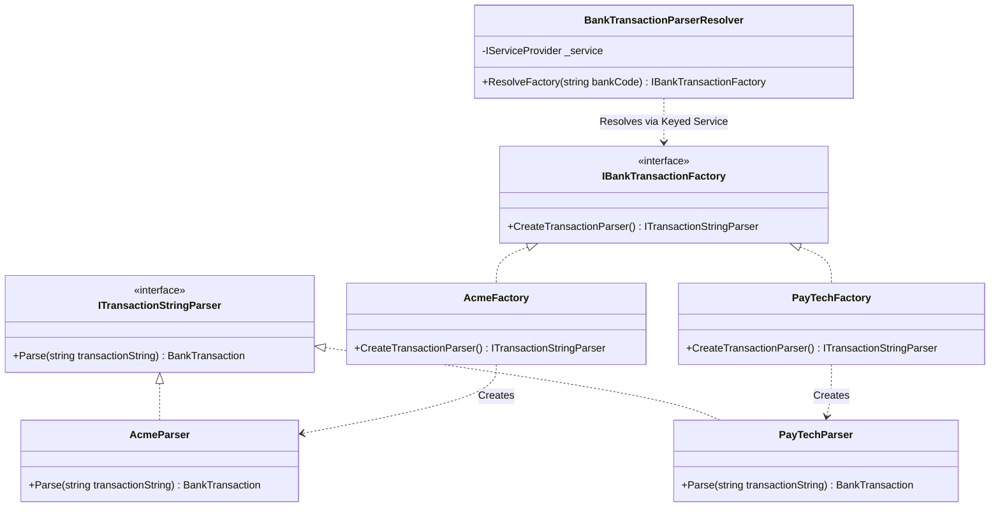

# Transaction Parsing & Zero-Allocation Spans

## 1. The Challenge of Bank-Specific String Formats

Commercial banks rarely adhere to unified, modern REST/JSON standards for transaction records. In banking interfaces, transactions often arrive as compact, proprietary delimited strings designed decades ago for telecommunications bandwidth optimization.

For example, among Finova's contracted banking partners:
- **Acme Bank** formats transactions with double-slash delimiters:
  `"1500.50//REF-ACME-9081//202610231430"`
  *(Pattern: Amount//Reference//Date(yyyyMMddHHmm))*
- **PayTech Bank** formats transactions with comma, hash, and slash delimiters:
  `"202610231430,1500.50#REF-PT-1002#dept/finance/customer/9041"`
  *(Pattern: Date,Amount#Reference#Key/Value/Key/Value)*

A high-performance wallet platform must accomplish two goals:
1. Provide an **extensible architecture** that isolates bank-specific parsing rules and makes adding new banking partners straightforward.
2. Achieve **maximum memory efficiency**, avoiding millions of temporary string allocations when processing batches containing hundreds of thousands of transactions.

---

## 2. Factory-Based Parser Resolution

Finova implements the **Factory Pattern** backed by modern **.NET Keyed Services** to resolve the correct parser at runtime based on the bank code:



### 2.1 Registration via Keyed Services
In [TransactionsApplicationExtension.cs](file:///Users/mostafa/IamBack/dotnet-csharp/Finova/Wallet/Modules/Transactions.Module/Application/Extensions/TransactionsApplicationExtension.cs):

```csharp
services.AddKeyedScoped<IBankTransactionFactory, AcmeFactory>("Acme");
services.AddKeyedScoped<IBankTransactionFactory, PayTechFactory>("PayTech");
services.AddKeyedScoped<IBankTransactionFactory, GothamPaymentsFactory>("GothamPayments");
services.AddKeyedScoped<IBankTransactionFactory, BanqueTechFactory>("BanqueTech");
services.AddScoped<BankTransactionParserResolver>();
```

### 2.2 Dynamic Resolution
In [BankTransactionParserResolver.cs](file:///Users/mostafa/IamBack/dotnet-csharp/Finova/Wallet/Modules/Transactions.Module/Application/Services/BankTransactionParserFactory/BankTransactionParserResolver.cs):

```csharp
public IBankTransactionFactory ResolveFactory(string bankCode)
{
    var factoryServices = service.GetKeyedService<IBankTransactionFactory>(bankCode);
    return factoryServices ?? throw new ArgumentException($"Unsupported bank: {bankCode}");
}
```

---

## 3. Why `Span<T>` and `ReadOnlySpan<T>`?

### 3.1 The Cost of Traditional String Operations
Consider a standard implementation of parsing `"1500.50//REF-ACME-9081//202610231430"`:
```csharp
// ANTI-PATTERN: Heap Allocation Storm
string[] parts = transactionString.Split("//"); // Allocates string[] array + 3 new strings
decimal amount = decimal.Parse(parts[0]);
string reference = parts[1];
DateTime date = DateTime.ParseExact(parts[2], ...);
```

When ingesting **1,000,000 transactions**, this naive approach allocates:
- **1,000,000 array objects** on the managed heap.
- **3,000,000 string objects** on the managed heap.
- Over **150+ MB of garbage** that forces frequent Garbage Collector (GC) Generation 0 and Generation 1 sweeps, inducing CPU spikes and latency jitter.

### 3.2 Zero-Allocation Slicing with `ReadOnlySpan<char>`
`ReadOnlySpan<char>` represents a contiguous view of an existing memory buffer on the stack. Slicing a span (`span[..separator]`) creates a lightweight pointer and length struct without allocating any new heap memory.

.NET 10 provides overloads for `decimal.TryParse` and `DateTime.TryParseExact` that accept `ReadOnlySpan<char>` directly, eliminating intermediate string conversions entirely.

---

## 4. Parser Implementation Analysis

### 4.1 AcmeParser
From [AcmeParser.cs](file:///Users/mostafa/IamBack/dotnet-csharp/Finova/Wallet/Modules/Transactions.Module/Application/Services/BankTransactionParserFactory/AcmeParser.cs):

```csharp
public BankTransaction Parse(string transactionString)
{
    ArgumentException.ThrowIfNullOrWhiteSpace(transactionString);

    // 1. Convert to Span - Zero heap allocation
    ReadOnlySpan<char> chars = transactionString.AsSpan();

    // 2. Locate delimiters
    var firstSeparator = chars.IndexOf("//");
    var secondSeparator = chars.LastIndexOf("//");

    if (firstSeparator <= 0 || secondSeparator <= firstSeparator)
        throw new FormatException("Invalid transaction format.");

    // 3. Slice and parse amount directly from memory
    decimal parsedAmount = GetAmount(chars, firstSeparator);

    // 4. Slice and parse date directly from memory
    DateTime parsedDate = GetDate(chars, secondSeparator);

    // 5. Extract reference
    string reference = chars[(firstSeparator + 2)..secondSeparator].ToString();

    return new BankTransaction
    {
        Amount = parsedAmount,
        Reference = reference,
        Date = parsedDate,
        Metadata = null
    };
}

private decimal GetAmount(ReadOnlySpan<char> chars, int separator)
{
    ReadOnlySpan<char> amount = chars[..separator];
    if (!decimal.TryParse(amount, out var parsedAmount))
        throw new FormatException("Cannot Parse the Amount");
    return Math.Round(parsedAmount, 2);
}

private DateTime GetDate(ReadOnlySpan<char> chars, int separator)
{
    ReadOnlySpan<char> date = chars[(separator + 2)..];
    if (!DateTime.TryParseExact(date, "yyyyMMddHHmm", CultureInfo.InvariantCulture,
            DateTimeStyles.AssumeUniversal | DateTimeStyles.AdjustToUniversal, out var parsedDate))
        throw new FormatException("Cannot Parse the Date");
    return parsedDate;
}
```

### 4.2 PayTechParser & Metadata Tokenization
From [PayTechParser.cs](file:///Users/mostafa/IamBack/dotnet-csharp/Finova/Wallet/Modules/Transactions.Module/Application/Services/BankTransactionParserFactory/PayTechParser.cs):

PayTech transactions include key-value metadata separated by slashes:
`"202610231430,1500.50#REF-PT-1002#dept/finance/customer/9041"`

The parser uses `metadata.Split('/')` which returns an enumerator over `Range` values, avoiding intermediate string arrays:

```csharp
ReadOnlySpan<char> metadata = chars[(thirdSeparator + 1)..];
var result = new Dictionary<string, string>(StringComparer.Ordinal);
var tokens = metadata.Split('/');

string? key = null;
foreach (var range in tokens)
{
    ReadOnlySpan<char> token = metadata[range];
    if (key is null)
    {
        if (token.IsEmpty) throw new FormatException("Metadata key cannot be empty.");
        key = token.ToString();
    }
    else
    {
        if (!result.TryAdd(key, token.ToString()))
            throw new FormatException($"Duplicate metadata key: {key}");
        key = null;
    }
}
if (key is not null) throw new FormatException("Metadata contains a key without a value.");
```

The resulting dictionary is serialized to a PostgreSQL JSONB `JsonDocument` in the `BankTransaction.Metadata` property.

---

## 5. Adding a New Bank Parser

To onboard a new partner bank (e.g., `NordicBank`):

1. **Add Enum Value**: Add `NordicBank` to [ContractedBanks](file:///Users/mostafa/IamBack/dotnet-csharp/Finova/Wallet/Modules/Banks.Module/Contracts/Enums/ContractedBanks.cs).
2. **Implement Parser**: Create `NordicBankParser : ITransactionStringParser` implementing `Parse(string transactionString)`.
3. **Implement Factory**: Create `NordicBankFactory : IBankTransactionFactory` returning `new NordicBankParser()`.
4. **Register in DI**: Add to [TransactionsApplicationExtension.cs](file:///Users/mostafa/IamBack/dotnet-csharp/Finova/Wallet/Modules/Transactions.Module/Application/Extensions/TransactionsApplicationExtension.cs):
   ```csharp
   services.AddKeyedScoped<IBankTransactionFactory, NordicBankFactory>("NordicBank");
   ```
5. **Add Unit Tests**: Add test cases to [TransactionParserTests.cs](file:///Users/mostafa/IamBack/dotnet-csharp/Finova/Wallet/Tests/UnitTesting/Transactions.Module.UnitTests/TransactionParserTests.cs) verifying format validation and edge cases.

---

## 6. Related Documentation

- [Transaction Processing Workflow](file:///Users/mostafa/IamBack/dotnet-csharp/Finova/docs/workflows/transaction-processing.md)
- [ADR-0005: Bank-Specific Parsers with Spans](file:///Users/mostafa/IamBack/dotnet-csharp/Finova/docs/decisions/0005-bank-specific-parsers.md)
