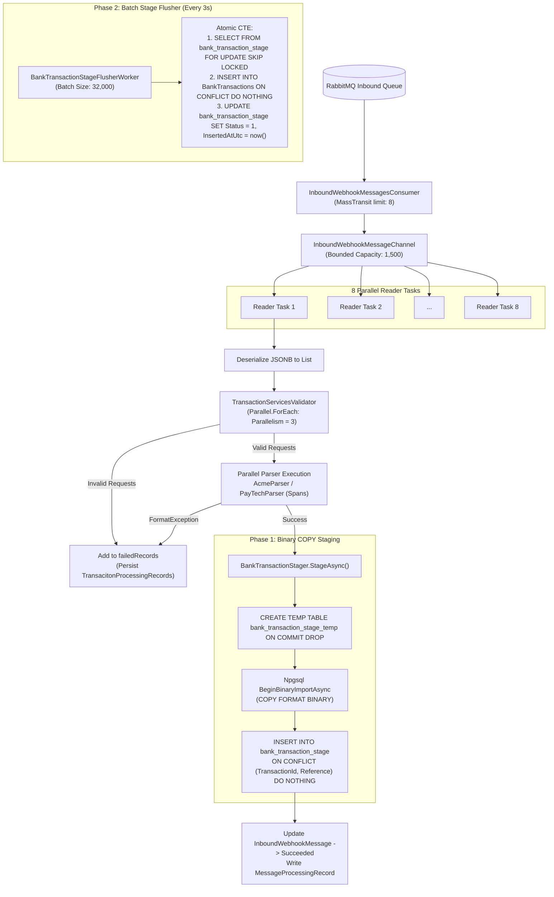

# Transaction Processing & High-Speed Staging

## 1. Overview

The transaction processing pipeline is responsible for taking an [InboundWebhookMessage](file:///Users/mostafa/IamBack/dotnet-csharp/Finova/Wallet/Modules/Banks.Module/Contracts/Entities/InboundWebhookMessage.cs) containing up to 1,000 individual transaction items, parsing their bank-specific transaction strings, validating business rules, and persisting them into the permanent ledger.

To sustain throughput exceeding 8,300+ transactions per second while maintaining atomic integrity, Finova implements a **Two-Phase Staging Architecture**:

1. **Phase 1: Binary COPY Staging**: Incoming parsed transactions are streamed directly into PostgreSQL via binary `COPY` into a temporary staging table, resolving conflicts at the staging boundary.
2. **Phase 2: Batch Ledger Flushing**: A dedicated background flusher drains un-inserted staged transactions in large sets of **32,000 rows** into the permanent `BankTransactions` ledger.

---

## 2. End-to-End Transaction Flow



---

## 3. Step-by-Step Processing Breakdown

### Step 1: Consumption and Channel Handoff
1. MassTransit delivers an `InboundWebhookMessage` to [InboundWebhookMessagesConsumer.cs](file:///Users/mostafa/IamBack/dotnet-csharp/Finova/Wallet/Host/Finova.Workers/OutboxWorker/Workers/InboundWebhookMessagesConsumer.cs).
2. The consumer enqueues a `WorkItem` into [InboundWebhookMessageChannel.cs](file:///Users/mostafa/IamBack/dotnet-csharp/Finova/Wallet/Host/Finova.Workers/OutboxWorker/Workers/InboundWebhookMessageChannel.cs).
3. The channel is bounded to **1,500 items** (`BoundedChannelFullMode.Wait`). If the worker pool is saturated, the channel writer pauses asynchronously, exerting natural backpressure upstream to RabbitMQ.

### Step 2: Parallel Channel Readers
Eight background reader tasks (`ReadMessagesAsync`) pull items concurrently from the channel. Each reader creates an independent `IServiceScope` to isolate database transactions.

### Step 3: Payload Deserialization and Validation
In [TransactionServices.cs](file:///Users/mostafa/IamBack/dotnet-csharp/Finova/Wallet/Modules/Transactions.Module/Application/Services/TransactionServices.cs#L68):
1. Deserializes `message.Payload` into `List<TransactionsRequest>`.
2. Invokes [TransactionServicesValidator.cs](file:///Users/mostafa/IamBack/dotnet-csharp/Finova/Wallet/Modules/Transactions.Module/Application/Services/TransactionRequestValidator.cs#L47) with bounded parallelism (`MaxDegreeOfParallelism = 3`):
   - Validates that `TransactionId`, `Source`, and `Destination` are non-empty GUIDs.
   - Asserts that `Source != Destination`.
   - Validates that `Currency` maps to a supported ISO currency enum.
   - Verifies the `Transaction` raw string is present.
3. Invalid requests are appended to `failedRecords` (`ConcurrentBag<TransacitonProcessingRecord>`) and written to the database with status `Rejected`. Valid requests proceed to parsing.

### Step 4: Factory Selection & Zero-Allocation Parsing
1. Resolves the parser factory for the bank code using .NET Keyed Services:
   ```csharp
   var factory = parserResolver.ResolveFactory(bankCode);
   var parser = factory.CreateTransactionParser();
   ```
2. Parses transaction strings concurrently (`MaxDegreeOfParallelism = 4`):
   - Slices strings using `ReadOnlySpan<char>` and `Span.Split('/')`.
   - Converts dates directly with `DateTime.TryParseExact`.
   - Converts amounts directly with `decimal.TryParse`.
3. If parsing encounters formatting errors (`FormatException`), the individual transaction is rejected and logged without aborting the rest of the batch.

### Step 5: Phase 1 — PostgreSQL Binary COPY Staging
In [BankTransactionStager.cs](file:///Users/mostafa/IamBack/dotnet-csharp/Finova/Wallet/Modules/Transactions.Module/Infrastructure/BankTransactionStager.cs):

Standard SQL `INSERT` statements generate severe query planning and serialization overhead when inserting 1,000 rows. Finova bypasses standard SQL parsing using **Npgsql's Binary Import (`COPY`) protocol**:

1. **Creates a Temporary Table**:
   ```sql
   CREATE TEMP TABLE bank_transaction_stage_temp
   (LIKE transactions.bank_transaction_stage INCLUDING DEFAULTS)
   ON COMMIT DROP;
   ```
2. **Streams Binary Data**:
   ```csharp
   await using var writer = await conn.BeginBinaryImportAsync(CopySql, ct);
   foreach (var t in items)
   {
       await writer.StartRowAsync(ct);
       await writer.WriteAsync(t.Id, NpgsqlDbType.Uuid, ct);
       await writer.WriteAsync(t.WebhookDeliveryId, NpgsqlDbType.Uuid, ct);
       await writer.WriteAsync(t.TransactionId, NpgsqlDbType.Uuid, ct);
       await writer.WriteAsync(t.Source, NpgsqlDbType.Uuid, ct);
       await writer.WriteAsync(t.Destination, NpgsqlDbType.Uuid, ct);
       await writer.WriteAsync((int)t.Currency, NpgsqlDbType.Integer, ct);
       await writer.WriteAsync(t.Amount, NpgsqlDbType.Numeric, ct);
       await writer.WriteAsync(t.Reference, NpgsqlDbType.Text, ct);
       await writer.WriteAsync(t.Date, NpgsqlDbType.TimestampTz, ct);
       await writer.WriteAsync(DateTime.UtcNow, NpgsqlDbType.TimestampTz, ct);
       await writer.WriteNullAsync(ct); // InsertedAtUtc
       await writer.WriteAsync(t.BankId, NpgsqlDbType.Uuid, ct);
       await writer.WriteAsync((short)0, NpgsqlDbType.Smallint, ct); // Status: Staged
       await writer.WriteAsync(t.Metadata, NpgsqlDbType.Jsonb, ct);
   }
   await writer.CompleteAsync(ct);
   ```
3. **Inserts into Staging with Conflict Deduplication**:
   ```sql
   INSERT INTO transactions.bank_transaction_stage
   SELECT * FROM bank_transaction_stage_temp
   ON CONFLICT ("TransactionId", "Reference") DO NOTHING;
   ```
4. Commits the transaction and drops the temp table automatically (`ON COMMIT DROP`).

### Step 6: Phase 2 — Batch Ledger Flushing
In [BankTransactionStageFlusher.cs](file:///Users/mostafa/IamBack/dotnet-csharp/Finova/Wallet/Modules/Transactions.Module/Infrastructure/BankTransactionStageFlusher.cs#L12), [BankTransactionStageFlusherWorker](file:///Users/mostafa/IamBack/dotnet-csharp/Finova/Wallet/Host/Finova.Workers/OutboxWorker/Workers/BankTransactionStageFlusherWorker.cs) periodically executes an atomic single-statement CTE targeting up to **32,000 staged transactions**:

```sql
WITH batch AS (
    SELECT "Id"
    FROM transactions.bank_transaction_stage
    WHERE "InsertedAtUtc" IS NULL
    ORDER BY "StagedAtUtc"
    LIMIT @batchSize
    FOR UPDATE SKIP LOCKED
),
ins AS (
    INSERT INTO transactions."BankTransactions"
        ("Id", "TransactionId", "WebhookDeliveryId", "Source", "Destination", "Currency",
         "Amount", "Reference", "Date", "BankId", "Metadata")
    SELECT s."Id", s."TransactionId", s."WebhookDeliveryId",
           s."Source", s."Destination", s."Currency", s."Amount", s."Reference", s."Date",
           s."BankId", s."Metadata"
    FROM transactions.bank_transaction_stage s
    JOIN batch b ON b."Id" = s."Id"
    ON CONFLICT ("TransactionId", "Reference") DO NOTHING
    RETURNING 1
),
marked AS (
    UPDATE transactions.bank_transaction_stage s
    SET "InsertedAtUtc" = now(),
        "Status" = 1
    FROM batch b
    WHERE s."Id" = b."Id"
    RETURNING 1
)
SELECT (SELECT count(*) FROM marked) AS claimed,
       (SELECT count(*) FROM ins)    AS inserted;
```

**Why This Is Ultra-Fast**:
- Performs row selection, ledger insertion, and status updating in a **single round-trip to PostgreSQL**.
- `FOR UPDATE SKIP LOCKED` allows multiple flusher workers to run concurrently without deadlocks.
- `ON CONFLICT ("TransactionId", "Reference") DO NOTHING` silently skips duplicate transactions, accurately reporting how many duplicates were ignored.

---

## 4. Failure and Audit Records

- **Message-Level Audit**: Every message records an entry in `transactions."MessageProcessingRecords"` documenting final state (`Processed`, `Rejected`, or `Failed`) and error reasons.
- **Transaction-Level Audit**: Individual malformed transactions within a valid delivery are stored in `transactions."TransacitonProcessingRecords"` using binary `COPY` with `ON CONFLICT ("TransactionId") DO NOTHING`, preserving an immutable audit trail of all rejected transactions.

---

## 5. Related Documentation

- [Outbox Processing Workflow](file:///Users/mostafa/IamBack/dotnet-csharp/Finova/docs/workflows/outbox-processing.md)
- [Transaction Parsing Workflow](file:///Users/mostafa/IamBack/dotnet-csharp/Finova/docs/workflows/transaction-parsing.md)
- [Idempotency Strategy](file:///Users/mostafa/IamBack/dotnet-csharp/Finova/docs/workflows/idempotency.md)
- [ADR-0007: Two-Phase Transaction Staging and Binary COPY](file:///Users/mostafa/IamBack/dotnet-csharp/Finova/docs/decisions/0007-transaction-staging-and-bulk-copy.md)
