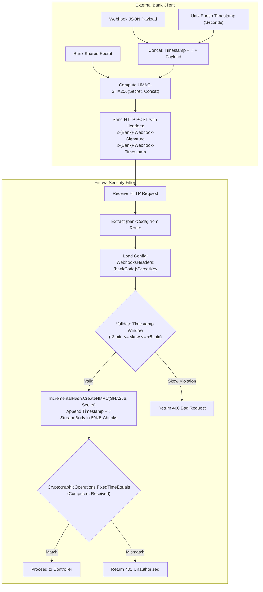

# Webhook Authentication & Cryptographic Security

## 1. Threat Model & Why Public URLs Cannot Be Trusted

Partner banks communicate with Finova by issuing HTTP POST webhooks across the public internet. This public exposure introduces critical security threats:

1. **Spoofing / Forged Transactions**: Malicious actors discovering the webhook URL could construct synthetic credit notifications, artificially inflating wallet balances.
2. **Replay Attacks**: Attackers eavesdropping on network traffic could intercept a valid banking webhook and retransmit it repeatedly to duplicate credit balances.
3. **Payload Tampering**: In the absence of end-to-end cryptographic integrity, an intermediary or compromised proxy could alter beneficiary accounts or transaction amounts.
4. **URL Obfuscation Fallacy**: Relying on "secret" or rotating URLs (e.g., `/api/webhooks/d9f1-a482-99fe`) is security through obscurity. URLs leak in access logs, HTTP headers, CDN analytics, and proxy caches. Once an obfuscated URL leaks, the endpoint is fully compromised until updated across both institutions.

Finova resolves these threats by requiring **cryptographic HMAC-SHA256 signature verification and timestamp replay protection** on every incoming webhook.

---

## 2. Authentication Architecture



---

## 3. How Shared-Secret Verification Works

### 3.1 Bank Identification
The endpoint route contains the bank's identifier:
`POST /api/bank-webhook/{bankCode}/transaction`

[RequestUtilities.cs](/Wallet/Shared/Services/RequestUtilities.cs) extracts `{bankCode}` (e.g., `Acme`, `PayTech`) from `context.RouteData.Values`.

### 3.2 Configuration Lookup
[WebhookAuthenticationConfiguration.cs](/Wallet/Modules/Banks.Module/Application/Services/WebhookFilter/WebhookAuthenticationConfiguration.cs) resolves the bank's configuration keys from `appsettings.json`:

```json
{
  "WebhooksHeaders": {
    "Acme": {
      "Signature": "x-Acme-Webhook-Signature",
      "Timestamp": "x-Acme-Webhook-Timestamp",
      "SecretKey": "YOUR_ACME_SHARED_SECRET_KEY"
    },
    "PayTech": {
      "Signature": "x-PayTech-Webhook-Signature",
      "Timestamp": "x-PayTech-Webhook-Timestamp",
      "SecretKey": "YOUR_PAYTECH_SHARED_SECRET_KEY"
    }
  }
}
```

### 3.3 Timestamp Validation and Replay Protection
In [WebhookRequestAuthenticator.cs](/Wallet/Modules/Banks.Module/Application/Services/WebhookFilter/WebhookRequestAuthenticator.cs#L95):
1. Reads the header `x-{bankCode}-Webhook-Timestamp`.
2. Parses the value as a 64-bit Unix timestamp integer.
3. Computes the permissible time envelope:
   ```csharp
   var nowTicks = DateTime.UtcNow.Ticks;
   var minimumAllowedTimestampTicks = nowTicks - TimeSpan.TicksPerMinute * 3; // -3 min
   var maximumAllowedTimestampTicks = nowTicks + TimeSpan.TicksPerMinute * 5; // +5 min
   ```
4. If the timestamp is older than 3 minutes (stale/replayed) or more than 5 minutes in the future (severe clock desynchronization), the filter immediately aborts with:
   `400 Bad Request: Timestamp is outside the allowed time window.`

### 3.4 Streaming HMAC Calculation
In [BankWebhookAuthorizationService.cs](/Wallet/Modules/Banks.Module/Application/Services/WebhookFilter/BankWebhookAuthorizationService.cs#L76):

Loading entire 3 MB request payloads into a single memory buffer to calculate a hash causes excessive heap allocations and LOH (Large Object Heap) fragmentation. Finova streams the request body in **81,920-byte (80 KB) buffers** using `System.Security.Cryptography.IncrementalHash`:

```csharp
request.EnableBuffering();
if (request.Body.CanSeek) request.Body.Position = 0;

using var hmac = IncrementalHash.CreateHMAC(
    HashAlgorithmName.SHA256,
    _webhookSignatureInputs.SecretKeyBytes
);

// 1. Append timestamp bytes
hmac.AppendData(_webhookSignatureInputs.TimestampBytes);

// 2. Append separator '.'
hmac.AppendData(webhookAuthenticationSettings.EncodeUtf8("."));

// 3. Stream body chunks
var buffer = new byte[81920];
int bytesRead;
while ((bytesRead = await request.Body.ReadAsync(buffer, cancellationToken)) > 0)
{
    hmac.AppendData(buffer, 0, bytesRead);
}

// 4. Reset stream position for downstream model binding
if (request.Body.CanSeek) request.Body.Position = 0;

byte[] expectedSignature = hmac.GetHashAndReset();
```

### 3.5 Constant-Time Signature Comparison
Comparing cryptographic byte arrays using conventional equality operators (`==` or `SequenceEqual`) is vulnerable to **timing side-channel attacks**, where an attacker measures slight nanosecond response variations to deduce characters of the signature.

Finova executes constant-time evaluation using .NET's built-in cryptographic utility:
```csharp
var isSignaturesMatch = CryptographicOperations.FixedTimeEquals(
    expectedSignature,
    _webhookSignatureInputs.SignatureBytes
);

if (!isSignaturesMatch)
{
    context.Result = new UnauthorizedObjectResult(new ProblemDetails
    {
        Status = StatusCodes.Status401Unauthorized,
        Title = "Invalid Webhook Key",
        Detail = "Provide a valid webhook"
    });
}
```

---

## 4. Evaluation: Rotating URLs vs. Cryptographic Signatures

During system design, generating rotating webhook URLs for each bank was evaluated as an alternative security barrier:

| Evaluation Criteria | Rotating Webhook URLs | Shared-Secret Cryptographic Signatures |
| :--- | :--- | :--- |
| **Payload Integrity** | **None**: An attacker who obtains the URL can modify amounts or account numbers at will. | **Complete**: Any change to even a single character in the payload invalidates the HMAC. |
| **Replay Protection** | **None**: The same URL can be hit repeatedly until rotated. | **Guaranteed**: Timestamp window rejects replayed packets after 3 minutes. |
| **Operational Overhead** | **Very High**: Requires coordination schedules between Finova and bank ops to rotate endpoints without downtime. | **Low**: Secrets are established once during onboarding and rotated only on security policy intervals. |
| **Tamper Resistance** | **Low**: URLs are visible in proxy logs and monitoring dashboards. | **High**: Secret keys never leave secure server-side storage and never travel over the wire. |

**Architectural Decision**: Shared-secret HMAC verification provides cryptographically guaranteed integrity, non-repudiation, and replay resistance without the severe operational failure modes of rotating URLs.

---

## 5. Security Checklist for Production

- [ ] Inject `WebhooksHeaders:{bankCode}:SecretKey` via Azure Key Vault, AWS Secrets Manager, or Kubernetes Secrets—never commit plain secrets.
- [ ] Ensure NTP time synchronization is active across host nodes to prevent false clock-skew rejections.
- [ ] Verify HTTPS termination enforces TLS 1.3 to protect timestamp and signature headers in transit.

---

## 6. Related Documentation

- [Webhook Ingestion Workflow](/docs/workflows/webhook-ingestion.md)
- [ADR-0006: Shared-Secret Webhook Authentication](/docs/decisions/0006-shared-secret-webhook-authentication.md)
